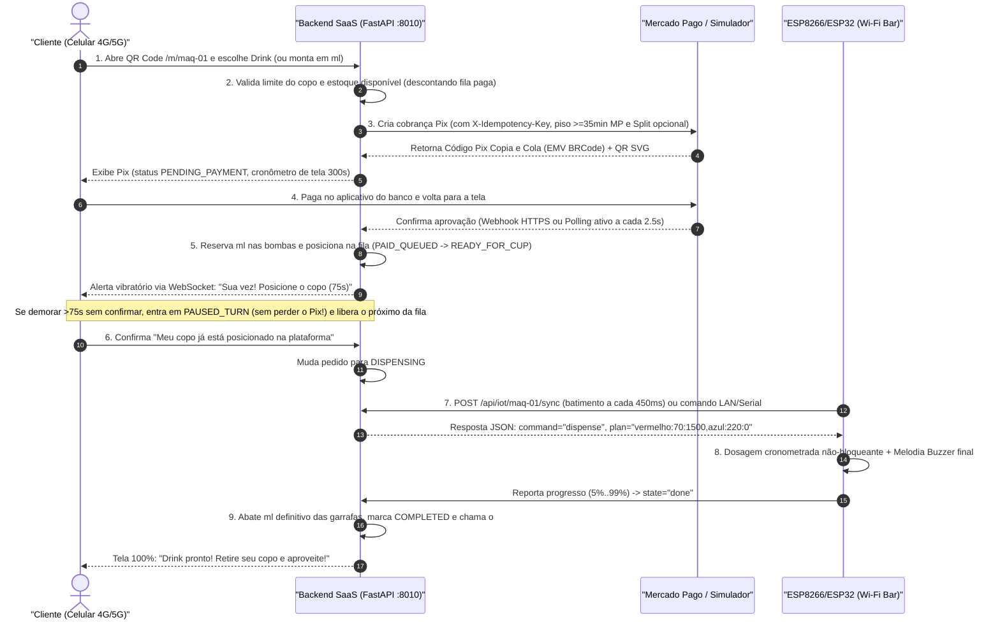

# 🍹 Bartender.OS v3.0 — Plataforma Comercial SaaS Multi-Bares, Pix & CRUD (`R$/ml`)

> **Isolamento de Edições no GitHub:**
> - **Branch `v3-saas-pagamentos` (Esta Edição — Porta `8010`):** Plataforma comercial **Hardware-as-a-Service (HaaS) + SaaS Multi-Tenant** com QR Code exclusivo por máquina, pagamento **Pix (Mercado Pago Oficial + Simulador)**, fila virtual com trava obrigatória de copo (`75s`), CRUD de Garrafas (`R$/ml`) e Drinks, e sincronização **Cloud IoT + Auto-Descoberta Zero-Config**.
> - **Branch `v2-esp32` (Edição Eventos — Porta `8000`):** Versão dedicada a open-bar em casamentos, feiras corporativas e totens touch locais sem cobrança.

---

## 📑 Sumário Ordenado da Arquitetura

1. [Pitch Comercial B2B & Proposta de Valor](#-1-pitch-comercial-b2b--proposta-de-valor-bares-franquias-casas-noturnas-e-eventos)
2. [Arquitetura Completa de Funcionamento (Ordenada em 5 Camadas)](#-2-arquitetura-completa-de-funcionamento-ordenada-em-5-camadas)
3. [Fluxo Operacional e Financeiro Passo a Passo (Pix → Fila → Copo → Dosagem → Estoque)](#-3-fluxo-operacional-e-financeiro-passo-a-passo-pix--fila--copo--dosagem--estoque)
4. [Máquina de Estados do Pedido & Fila Anti-Desperdício (10 Estados)](#-4-máquina-de-estados-do-pedido--fila-anti-desperdício-10-estados)
5. [Engenharia de Precificação Inteligente (`R$/ml`) & Split SaaS](#-5-engenharia-de-precificação-inteligente-rml--split-saas)
6. [Arquitetura do Motor Zero-Config de Rede & Cloud Sync IoT (`network_discovery.py`)](#-6-arquitetura-do-motor-zero-config-de-rede--cloud-sync-iot-network_discoverypy)
7. [Estrutura Ordenada do Repositório & Mapa de Documentação](#-7-estrutura-ordenada-do-repositório--mapa-de-documentação)
8. [Como Iniciar em 1 Clique e Acessos Rápidos](#-8-como-iniciar-em-1-clique-e-acessos-rápidos)

---

## 💼 1. Pitch Comercial B2B & Proposta de Valor (Bares, Franquias, Casas Noturnas e Eventos)

O **Bartender.OS v3.0** transforma qualquer metro quadrado de balcão em um ponto de venda autônomo de alta margem, eliminando os três maiores gargalos financeiros da operação noturna: **filas no bar, desperdício de destilados (*over-pouring*) e custo fixo de terminais/totens**.

| Desafio Tradicional do Bar | Solução Comercial Bartender.OS v3.0 | Impacto Direto no Caixa |
| :--- | :--- | :--- |
| **Totem touch + maquininha cara no balcão** | **Zero Totem (`BYOD`):** o próprio celular do cliente no **4G/5G** é o cardápio e o terminal Pix via QR Code impresso em acrílico/PVC. | **Redução de até 70% no CAPEX** por estação instalada e zero manutenção de tela quebrada/molhada. |
| **Doses no "olhômetro" e perdas de estoque** | **Dosagem milimétrica cronometrada + Reserva em trânsito:** cada `ml` tem preço e custo exatos (`R$/ml`), travando vendas antes da garrafa secar. | **Padronização 100% da receita** e previsibilidade real de lucro por garrafa. |
| **Bebida derramada sem copo no bico** | **Trava Obrigatória de Copo + Janela de `75s`:** a bomba jamais liga sozinha ao aprovar o Pix; exige confirmação presencial no celular na hora da vez. | **Zero desperdício de bebida** e fila sempre andando (`PAUSED_TURN` automático se o cliente demorar). |
| **TI complexa (IP fixo / abrir portas no roteador)** | **Cloud Sync Outbound (`450ms`) + Descoberta Zero-Config (`UDP :4210`, `ARP`, `Sweep /24`):** a placa conecta no Wi-Fi `2.4 GHz` do bar e sincroniza sozinha. | **Instalação Plug & Play em minutos**, sem precisar abrir portas no roteador e imune a CGNAT. |
| **Modelo de receita escalável para franqueadores** | **Multi-Tenant Nativo + Split de Pagamento (`%`):** Super-Admin gerencia dezenas de bares e configura comissão percentual por transação. | **Receita recorrente (`SaaS + Take-Rate %`)** auditável em tempo real. |

---

## 🏗️ 2. Arquitetura Completa de Funcionamento (Ordenada em 5 Camadas)

A plataforma é dividida em **5 camadas ordenadas**, conectando a experiência mobile do consumidor final no 4G/5G até o acionamento das 4 bombas 12V no balcão do bar:

```mermaid
flowchart TB
    subgraph L1["Camada 1 · Jornadas Web & Mobile (React 19 + TypeScript + Tailwind v4)"]
        CUST["📱 Jornada do Cliente (/m/maq-01)\nCardápio Dinâmico + Monte seu Drink (R$/ml) + Checkout Pix + Fila ao Vivo"]
        OWNER["💼 Painel Dono do Bar (/painel)\nCRUD Garrafas (3 modos), CRUD Drinks, Estoque Vivo, QR SVG, Pix & Reembolsos"]
        SUPER["🌐 Painel Super-Admin (/superadmin)\nOnboarding Multi-Bares, Split % da Plataforma e Auditoria Global"]
    end

    subgraph L2["Camada 2 · API Multi-Tenant, Segurança & Motor Pix (FastAPI Python :8010)"]
        AUTH["🔐 Autenticação & RBAC (auth.py)\nPBKDF2-HMAC-SHA256 (200k) + JWT HS256 + Isolamento Anti-IDOR por bar_id"]
        PAY["🏦 Motor Financeiro Pix (payments.py)\nMercado Pago Oficial (/v1/payments + Split + Refunds) + Simulador EMV BRCode"]
        WS["📡 Hub WebSocket Tempo Real (/api/ws/machines/:slug)\nPush Instantâneo de Fila, Telemetria de Bombas e Estoque"]
    end

    subgraph L3["Camada 3 · Persistência Transacional & Orquestração de Fila"]
        DB[("🗄️ SQLite 3 WAL Multi-Tenant (database.py)\nTabelas: platform_admins, bars, bottles, machines, machine_pumps, drinks, orders")]
        QUEUE["⏳ Máquina de Estados da Fila & Runtime (machine_runtime.py)\nReserva de ml em Trânsito + Janela 75s + PAUSED_TURN + Worker 2.5s"]
    end

    subgraph L4["Camada 4 · Motor Zero-Config de Rede & Transporte IoT (network_discovery.py)"]
        WIFI["📶 Detecção Automática de Rede (netsh wlan)\n5 GHz -> Irmão 2.4 GHz + Multi-WiFi (secrets.h) + QR Code com IP LAN Real"]
        SCAN["🔍 Descoberta & Provisionamento do ESP em 4 Camadas\n1. UDP :4210 (Push Cloud URL) | 2. Cache/mDNS | 3. ARP | 4. Sweep /24 + Ponte SoftAP"]
        CLOUD["☁️ Endpoint Cloud Sync Outbound (/api/iot/:slug/sync)\nComandos Assíncronos: dispense | stop | update_pumps"]
    end

    subgraph L5["Camada 5 · Hardware Embarcado Híbrido & Potência 12V (bombas/bombas.ino)"]
        ESP["🤖 Firmware C++ Não-Bloqueante (ESP8266 NodeMCU / ESP32-WROOM-32)\nMáquina millis() + Guarda Anti-Jitter 450ms + Calibração Flash NVS/EEPROM"]
        PUMPS["⚡ Módulo Relé 4 Canais / ULN2803A -> 4 Bombas 12V + LED + Buzzer Musical"]
    end

    L1 <-->|"HTTPS REST + WebSocket"| L2
    L2 <--> L3
    L3 <--> L4
    L4 <-->|"Cloud Sync Outbound (450ms) / HTTP LAN / UDP :4210 / USB Serial"| ESP
    ESP --> PUMPS
```



---

## 🔄 3. Fluxo Operacional e Financeiro Passo a Passo (Pix → Fila → Copo → Dosagem → Estoque)



---

## ⏳ 4. Máquina de Estados do Pedido & Fila Anti-Desperdício (10 Estados)

Para permitir que dezenas de clientes comprem ao mesmo tempo sem nunca acionar as bombas sem copo posicionado, cada pedido percorre uma máquina de estados transacional auditável:

| Ordem | Estado (`OrderStatus`) | Gatilho de Entrada | Regra de Negócio e Proteção de Estoque |
| :---: | :--- | :--- | :--- |
| **1** | `PENDING_PAYMENT` | Cliente cria pedido (`/orders/preset` ou `/custom`) | Gera Pix Copia e Cola e QR SVG; ainda não bloqueia estoque físico. |
| **2** | `CANCELED` | Cliente desiste antes de pagar (`/cancel`) | Encerra cobrança limpa sem impactar a fila. |
| **3** | `EXPIRED` | Passou de `300s` sem pagamento | Expira na tela, mas aceita conciliação tardia caso o banco liquide no último segundo. |
| **4** | `PAID_QUEUED` | Pix aprovado (Webhook, Polling ou Simulador) | **Reserva imediatamente os `ml` em trânsito** nas 4 bombas e entra na fila por ordem de pagamento. |
| **5** | `READY_FOR_CUP` | Pedido chega na **Posição #1** da máquina | Abre janela exclusiva de **`75 segundos`** e alerta o celular do cliente para posicionar o copo. |
| **6** | `PAUSED_TURN` | Cliente na Posição #1 não confirma o copo em `75s` | **Protege o Pix pago** (mantendo os `ml` reservados), mas **libera a máquina para o `#2` da fila**! O cliente retoma o `#1` tocando em *"Estou na máquina"* (`/resume-turn`). |
| **7** | `DISPENSING` | Cliente confirma `"Copo posicionado na plataforma"` | Envia comando de preparo ao ESP (`cloud_iot`, `wifi`, `serial` ou `simulator`) e transmite `%` ao vivo. |
| **8** | `COMPLETED` | ESP conclui 100% da dosagem + melodia | **Abate definitivamente os `ml`** do saldo `remaining_ml` das garrafas e consolida o DRE do bar. |
| **9** | `FAILED_DISPENSE` | Parada de emergência ou falha física durante preparo | Preserva registro para o dono do bar **Reenviar para a Fila (`/retry`)** em 1 clique sem cobrar de novo. |
| **10** | `REFUNDED` | Dono do bar aciona **Estornar Pix (`/refund`)** | Devolve o valor na API do Mercado Pago (`/v1/payments/{id}/refunds`) e libera os `ml` reservados. |

---

## 💰 5. Engenharia de Precificação Inteligente (`R$/ml`) & Split SaaS

O **Bartender.OS v3.0** opera nativamente com **contabilidade em centavos inteiros por litro (`price_per_liter_cents`)**, garantindo precisão sub-centavo por mililitro sem erros de arredondamento:

1. **Precificação de Garrafas em 3 Modos no `/painel` (`BottlesCrudSection.tsx`):**
   - **Modo 1 · Pela Dose de `50 ml`:** Ex.: definir a dose de Gin a `R$ 15,00` configura automaticamente `R$ 300,00/L` (`R$ 0,30/ml`).
   - **Modo 2 · Pela Meta de Faturamento da Garrafa:** Informe quanto deseja apurar na garrafa inteira; o sistema desconta a perda técnica de purga (`loss_pct`, padrão `3%`) e calcula o `R$/ml`.
   - **Modo 3 · Por Multiplicador de Markup (`2x`, `3x`, `4x`):** Aplica o multiplicador sobre o custo de compra da garrafa e projeta o **lucro líquido exato**.
2. **Dois Modos de Preço por Receita de Drink (`DrinksCrudSection.tsx`):**
   - **Automático pelos `ml` (`auto_ml`):** Soma o preço por `ml` de cada bomba usada na receita + taxa opcional de copo/gelo (`cup_fee_cents`, ex.: `R$ 1,50`) e aplica eventual `%` de desconto promocional do combo. Se o custo da garrafa mudar, todos os drinks atualizam sozinhos!
   - **Preço Fixo (`fixed`):** Permite fixar valores comerciais (ex.: `R$ 19,90`) mantendo a apuração real de CMV e margem líquida nos relatórios.
3. **Split de Pagamento Plataforma × Bar (`platform_fee_percent`):**
   - Cada bar possui sua taxa contratual configurada pelo Super-Admin (ex.: `5%`).
   - Em cada pedido aprovado, o banco registra `total_cents`, `cost_total_cents`, `platform_fee_cents` e `bar_net_cents`.

---

## 🔍 6. Arquitetura do Motor Zero-Config de Rede & Cloud Sync IoT (`network_discovery.py`)

Para eliminar qualquer dor de cabeça com redes Wi-Fi, IPs dinâmicos ou portas USB trocadas, a v3.0 combina **Cloud Sync Outbound** com o motor **`network_discovery.py`**:

1. **Cloud Sync Outbound (`POST /api/iot/{machine_slug}/sync`):**
   - O `ESP8266` / `ESP32` inicia conexões HTTP de saída a cada `450ms–800ms` usando o Wi-Fi `2.4 GHz` do bar. Não é necessário abrir portas no roteador nem ter IP fixo.
2. **Detecção Automática `5 GHz -> 2.4 GHz` e Multi-WiFi (`bombas/secrets.h`):**
   - Ao iniciar `server.py` (ou clicar em **"Sincronizar Rede"** na aba Máquinas do `/painel`), o backend inspeciona o Wi-Fi do Windows (`netsh wlan`), resolve automaticamente o perfil irmão `2.4 GHz` caso o PC esteja conectado no `5 GHz`, e grava todas as redes salvas em `SECRET_KNOWN_WIFI_LIST`.
3. **Localização e Auto-Configuração do ESP em 4 Camadas (`discover_esp_on_network`):**
   - **Camada 1 (Broadcast UDP `:4210`):** Envia `BARTENDER_DISCOVER|<sync_url>|<api_token>`; o ESP responde em `< 200ms` e **já atualiza automaticamente na sua Flash a URL de Cloud Sync com o IP atual do servidor**!
   - **Camada 2 (Candidatos Diretos):** IP em cache, SoftAP (`192.168.4.1`) e mDNS (`bartender.local`).
   - **Camada 3 (Tabela ARP):** Sondagem paralela dos vizinhos ativos na sub-rede (`arp -a`).
   - **Camada 4 (Varredura `/24`):** 128 workers assíncronos varrendo a sub-rede local em `~1.2s`.
4. **Provisionamento via Ponte SoftAP ou Cabo USB Serial:**
   - Se a placa estiver em uma rede nova (com o AP `Bartender-Config` / `Bartender-ESP32` aberto ou conectada via cabo USB em qualquer porta `COMx`), o servidor injeta automaticamente as novas credenciais Wi-Fi e a URL de Cloud Sync sem precisar regravar o firmware!

---

## 📂 7. Estrutura Ordenada do Repositório & Mapa de Documentação

Cada diretório possui um `README.md` especializado:

```text
projetobartender-v3/
├── backend/                                   # [README] Servidor SaaS Multi-Tenant (FastAPI)
│   ├── app/                                   # [README] Núcleo de Negócios, Pix, Fila e IoT
│   │   ├── main.py                            # Rotas (/api/auth, /api/public, /api/bar, /api/superadmin, /api/iot)
│   │   ├── auth.py                            # PBKDF2-SHA256 + JWT HS256 + Isolamento Multi-Bar
│   │   ├── database.py                        # SQLite WAL, R$/ml, Reserva em Trânsito e Fila 75s
│   │   ├── payments.py                        # Mercado Pago Pix Oficial + Split + Refunds + EMV BRCode SVG
│   │   ├── machine_runtime.py                 # MachineExecutor, Cloud Sync IoT, WebSocket Pub/Sub e Worker 2.5s
│   │   ├── network_discovery.py               # Motor Zero-Config (UDP 4210, ARP, Sweep /24, SoftAP Bridge, USB)
│   │   ├── models.py                          # Schemas Pydantic v2 estritos em centavos (*_cents)
│   │   └── config.py                          # Settings (.env) + Auto-geração de .jwt_secret (384 bits)
│   ├── data/                                  # [README] Banco SQLite WAL (bartender_v3.db) e ERD completo
│   ├── tests/                                 # [README] Suíte E2E automatizada pytest (test_v3_saas.py)
│   ├── requirements.txt                       # Dependências Python
│   └── .env.example                           # Modelo de variáveis de ambiente
├── frontend/                                  # [README] SPA Mobile-First (React 19 + TS + Tailwind v4)
│   ├── src/                                   # [README] Roteamento das 3 Jornadas
│   │   ├── pages/                             # [README] CustomerMachinePage, BarAdminPage, SuperAdminPage
│   │   ├── components/                        # [README] Navbar, DrinkCard, CustomDrinkBuilder,
│   │   │   │                                  #          CustomerOrderSheet (Pix/Fila/Copo), GlassArtwork
│   │   │   └── admin/                         # [README] BottlesCrudSection, DrinksCrudSection, MachinesPumpsSection
│   │   ├── api/client.ts                      # [README] Cliente HTTP tipado com JWT + X-Bar-Id
│   │   ├── types/bartender.ts                 # [README] Contratos TypeScript espelhados com o backend
│   │   └── utils/format.ts                    # [README] Formatação BRL, volumes (ml) e durações
│   ├── package.json
│   └── vite.config.ts                         # Proxy de desenvolvimento para porta 8010
├── bombas/                                    # [README] Firmware Híbrido C++ (ESP8266 NodeMCU + ESP32-WROOM-32)
│   ├── bombas.ino                             # Cloud Sync Outbound (450ms) + UDP 4210 + HTTP LAN + USB Serial
│   └── secrets.example.h                      # Modelo de credenciais Wi-Fi e Cloud Sync
├── esquema/                                   # [README] Engenharia Eletrônica (KiCad 9, Fritzing e 16 PDFs de PCB)
├── iniciar_bartender.bat                      # Inicializador One-Click Windows (porta 8010)
├── parar_bartender.bat                        # Encerramento limpo do servidor v3.0
├── server.py                                  # Bootstrapper SaaS + Auto-Sync de Rede e Banner de URLs
└── README.md                                  # Este documento
```

### Tabela de Guias Especializados por Módulo:

| Diretório / Módulo | Público-Alvo | Conteúdo Detalhado |
| :--- | :--- | :--- |
| **[`backend/README.md`](./backend/README.md)** | Arquitetos SaaS, DevOps & Investidores | Visão executiva do servidor Multi-Tenant, variáveis `.env`, deploy HTTPS, segurança e requisitos. |
| **[`backend/app/README.md`](./backend/app/README.md)** | Engenheiros de Backend & Integradores | Catálogo completo de rotas REST/WebSocket, máquina de estados da fila, autenticação JWT/PBKDF2, Pix e `network_discovery`. |
| **[`backend/data/README.md`](./backend/data/README.md)** | DBAs, Operações & Compliance | Esquema relacional SQLite `WAL` (ERD), isolamento por `bar_id`, `.jwt_secret` auto-gerado e rotinas de backup. |
| **[`backend/tests/README.md`](./backend/tests/README.md)** | QA & Engenharia de Confiabilidade | Suíte E2E automatizada (`pytest`) cobrindo Pix, fila concorrente, trava de copo, estoque e multi-bar. |
| **[`frontend/README.md`](./frontend/README.md)** | Engenheiros Frontend & UX/Produto | Aplicação React SPA mobile-first: jornada QR Code 4G, construtor `R$/ml`, Painel do Bar e Super-Admin. |
| **[`bombas/README.md`](./bombas/README.md)** | Engenheiros de Firmware & Instaladores | Firmware C++ híbrido `ESP8266`/`ESP32`, Cloud Sync Outbound sem NAT, calibração Flash e protocolos. |
| **[`esquema/README.md`](./esquema/README.md)** | Engenharia Eletrônica & Fabricação | Projetos KiCad 9 e Fritzing, estágio de potência `12V` (`ULN2803A`/Relés), proteção flyback e PDFs de PCB. |

---

## 🚀 8. Como Iniciar em 1 Clique e Acessos Rápidos

Dê dois cliques em **`iniciar_bartender.bat`** dentro de `projetobartender-v3/` (e use **`parar_bartender.bat`** para encerrar) ou execute no PowerShell:

```powershell
.\.venv\Scripts\python.exe server.py
```

### Acessos Rápidos Locais (Porta `8010`):

| Área | URL | Credenciais Padrão (Demo) |
| :--- | :--- | :--- |
| **Visão do Cliente (QR Máquina #01)** | `http://localhost:8010/m/maq-01` | Livre (Autosserviço) |
| **Painel Dono do Bar (CRUD)** | `http://localhost:8010/painel` | `dono@bartropical.com` / `bar123` |
| **Painel Super-Admin (Multi-Bares)** | `http://localhost:8010/superadmin` | `superadmin@bartender.os` / `admin123` |
| **Swagger / Documentação da API** | `http://localhost:8010/docs` | — |
