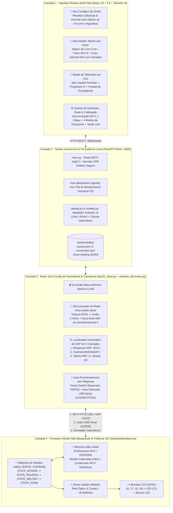

# 🍹 Bartender.OS v2.0 — Bartender Automático com ESP32 / ESP8266

> **Navegação de Edições no GitHub:**
> - **Branch `v2-esp32` (Esta Edição — Porta `8000`):** Operação local para eventos, casamentos, feiras corporativas e totens touch com preparo imediato e contingência offline total.
> - **Branch `v3-saas-pagamentos` (Edição SaaS Multi-Bares — Porta `8010`):** Plataforma comercial com QR Code por máquina, pagamento **Pix (Mercado Pago + Split)**, fila virtual com trava de copo (`75s`), CRUD de Garrafas (`R$/ml`) e painel Multi-Tenant.

Plataforma completa de **coquetelaria automatizada** controlada por microcontrolador **ESP32-WROOM-32** ou **ESP8266 NodeMCU**, com backend assíncrono em **FastAPI (Python)**, motor de **descoberta automática de rede Zero-Config (`network_discovery.py`)** e interface web moderna em **React 19 + TypeScript + Vite + Tailwind CSS v4**.

O sistema dosa cada ingrediente ao mililitro com base na vazão real calibrada de 4 bombas peristálticas/diafragma de 12V, exibindo o progresso ao vivo no navegador (computador, tablet/totem ou celular) via **WebSockets**.

---

## 📑 Sumário Ordenado

1. [Visão Executiva & Argumentos de Vendas Técnicas](#-1-visão-executiva--argumentos-de-vendas-técnicas-eventos-totens--ativações)
2. [Arquitetura Completa de Funcionamento (Ordenada por Camadas)](#-2-arquitetura-completa-de-funcionamento-ordenada-por-camadas)
3. [Fluxo Passo a Passo de um Pedido e Descoberta Zero-Config](#-3-fluxo-passo-a-passo-de-um-pedido-e-descoberta-zero-config)
4. [Áreas da Interface Web (Como o Aplicativo Funciona)](#-4-áreas-da-interface-web-como-o-aplicativo-funciona)
5. [Estrutura Ordenada do Repositório & Índice de Documentação](#-5-estrutura-ordenada-do-repositório--índice-de-documentação)
6. [Arquitetura de Hardware e Pinagem Segura (`ESP32` & `ESP8266`)](#-6-arquitetura-de-hardware-e-pinagem-segura-esp32--esp8266)
7. [Guia Completo: Como Fazer Tudo Funcionar do Zero](#-7-guia-completo-como-fazer-tudo-funcionar-do-zero)
8. [Como Calibrar as Bombas na Prática](#-8-como-calibrar-as-bombas-na-prática)
9. [Referência Ordenada de Rotas da API e Comandos do Firmware](#-9-referência-ordenada-de-rotas-da-api-e-comandos-do-firmware)
10. [Solução de Problemas Comuns (Troubleshooting)](#-10-solução-de-problemas-comuns-troubleshooting)

---

## 💼 1. Visão Executiva & Argumentos de Vendas Técnicas (Eventos, Totens & Ativações)

O **Bartender.OS v2.0** foi projetado especificamente para **operação comercial local de missão crítica** em casamentos, feiras corporativas, estandes promocionais, festivais e quiosques de autoatendimento (*totens touch*):

| Pilar Comercial | Diferencial Técnico Embarcado | Benefício Direto para o Cliente / Evento |
| :--- | :--- | :--- |
| **Zero Configuração de Rede (Plug & Play)** | Motor `network_discovery.py` que detecta o Wi-Fi atual do PC (`5 GHz → 2.4 GHz`), sincroniza `secrets.h` (Multi-WiFi) e localiza o ESP em **4 camadas** (`UDP :4210`, `Cache/mDNS`, `ARP` e `Sweep /24`). | Muda de roteador, usa Hotspot 4G do celular ou leva para qualquer salão de festas sem precisar descobrir IP nem editar código. |
| **Zero Queda em Eventos (Fallback Triplo)** | Modo `Auto` com chaveamento transparente **Wi-Fi HTTP → Cabo USB Serial (auto-detectado) → Simulador Volumétrico** + rede **SoftAP própria (`192.168.4.1`)** no ESP. | Opera 100% offline sem depender da internet do buffet. Se o Wi-Fi saturar com centenas de celulares, basta plugar o cabo USB em qualquer porta e continuar servindo. |
| **Demonstração Comercial sem Hardware** | **Simulador Volumétrico em Tempo Real** integrado ao backend Python usando as mesmas equações de vazão (`ml/s`). | Equipes de pré-venda demonstram o cardápio, o estúdio *"Monte seu Drink"* e a telemetria ao vivo em qualquer notebook ou tablet antes mesmo de levar a máquina física. |
| **Padronização & Desperdício Zero** | Dosagem cronometrada ao milissegundo a partir da calibração individual gravada na **Flash NVS/EEPROM** do microcontrolador + trava de copo em `450 ml`. | Custo por dose previsível ao centavo, sem sobre-dosagem (*over-pouring*) e sem risco de transbordar o copo no balcão. |
| **Segurança Elétrica e Operacional** | Pré-carga anti-pulso dos relés no boot, exclusão mútua `asyncio.Lock` contra cliques duplos e **Parada de Emergência (`< 50 ms`)**. | Nenhum esguicho acidental ao ligar a tomada; se o convidado retirar o copo antes da hora, um toque corta imediatamente as 4 bombas 12V. |
| **Experiência "Instagramável" Multi-Tela** | Copo vetorial SVG dinâmico com camadas reais, gelo e bolhas a 60 FPS + sincronização via **WebSocket (`/api/ws`)**. | O pedido feito no celular do convidado ou no totem atualiza simultaneamente o telão do bar com animação do jato líquido colorido em tempo real. |

---

## 🏛️ 2. Arquitetura Completa de Funcionamento (Ordenada por Camadas)

O sistema é estruturado em **4 camadas ordenadas**, garantindo separação limpa entre interface visual, regras de negócio, descoberta de rede e acionamento eletromecânico:



---

## 🔄 3. Fluxo Passo a Passo de um Pedido e Descoberta Zero-Config

### 3.1. Ciclo Ordenado de Descoberta e Provisionamento de Rede (`network_discovery.py`)
1. **Inspeção da Rede do Computador (`get_current_network_info`):** O backend consulta o sistema operacional (`netsh wlan`), identifica o `SSID` conectado e, caso o notebook esteja em uma rede `5 GHz` (ex.: `Evento_5G`), localiza automaticamente a rede irmã `2.4 GHz` (`Evento` / `Evento_2G`) compatível com o rádio do ESP.
2. **Sincronização Multi-WiFi (`sync_secrets_h_with_current_network`):** Atualiza automaticamente `bombas/secrets.h` com a rede alvo e uma lista de até 16 redes conhecidas (`SECRET_KNOWN_WIFI_LIST`).
3. **Localização do ESP em 4 Camadas Progressivas (`discover_esp_on_network`):**
   - **Camada 1 — Broadcast UDP (`porta 4210`, `< 200ms`):** Envia pacote `BARTENDER_DISCOVER`; o ESP responde na hora com seu IP real, modelo (`ESP32`/`ESP8266`) e `RSSI`.
   - **Camada 2 — Candidatos Diretos:** Testa o último IP válido em cache, a ponte SoftAP (`192.168.4.1`) e o hostname mDNS (`bartender.local`).
   - **Camada 3 — Tabela ARP (`arp -a`, `< 350ms`):** Sonda em paralelo todos os IPs vizinhos já conhecidos na sub-rede atual.
   - **Camada 4 — Varredura Assíncrona `/24` (`~1.2s`):** Dispara 128 workers assíncronos testando a assinatura JSON `/status` na sub-rede ativa, achando o ESP mesmo quando o roteador bloqueia mDNS e broadcast UDP.
4. **Provisionamento Automático (Ponte SoftAP ou USB Serial):** Se o ESP estiver em um local novo com o ponto de acesso `Bartender-ESP32` aberto (ou plugado no USB em qualquer porta `COMx`), o botão **"Sincronizar Rede do PC com o ESP"** (`POST /api/network/sync`) envia a nova senha do Wi-Fi diretamente para a placa sem precisar abrir a Arduino IDE!

### 3.2. Ciclo Ordenado de Preparo de um Drink (`esp32_client.py` + `bombas.ino`)
1. **Requisição:** O frontend envia `POST /api/dispense/{id}` (receita pronta) ou `POST /api/dispense/custom` (volumes escolhidos pelo usuário).
2. **Controle de Concorrência (`asyncio.Lock`):** O `ESP32Controller` garante que dois pedidos nunca sejam executados ao mesmo tempo (retornando `HTTP 409 Conflict` se já houver bebida em preparo).
3. **Plano de Dosagem:** O backend converte a receita em uma sequência ordenada de etapas no formato compacto `bomba:ml:pausa_ms` (ex.: `vermelho:70.0:1500,azul:220.0:0`).
4. **Cálculo Físico no ESP:** Para cada etapa, o firmware calcula o tempo exato de acionamento da bomba usando a vazão calibrada gravada na Flash:
   $$\text{tempo (ms)} = \left(\frac{\text{volume (ml)}}{\text{vazão (ml/s)}}\right) \times 1000$$
5. **Máquina de Estados Não-Bloqueante (`millis()`):** O ESP executa um loop contínuo de estados (`STATE_DOSING` → `STATE_PAUSING` → `STATE_MELODY` → `STATE_DONE`). Isso permite responder a `GET /status` em `< 5 ms` e executar `POST /stop` instantaneamente.
6. **Finalização Musical:** Ao concluir a última bomba, o ESP toca a melodia de vitória no buzzer (`GPIO 22` / `D7`) piscando o LED da antena (`GPIO 21` / `D0`) e sinaliza `DONE`.

---

## ✨ 4. Áreas da Interface Web (Como o Aplicativo Funciona)

A interface web foi projetada como um painel de mixologia interativo dividido em quatro áreas principais:

1. **Cardápio de Drinks (`Aba Cardápio`):**
   - Exibe receitas clássicas (*Red Robotics*, *Yellow Web*, *Green Games*, *Mix Basics*) e receitas autorais (*Brisa de Verão*, *Entardecer Tropical*), com filtro por categoria.
   - Renderiza um **copo vetorial dinâmico** com as cores e camadas proporcionais dos ingredientes, informando o **volume total (`ml`)** e o **tempo estimado (`segundos`)**.
2. **Estúdio "Monte seu Drink" (`Aba Monte seu Drink`):**
   - Permite criar uma bebida personalizada ajustando controles deslizantes (`sliders` de `5 em 5 ml` ou botões rápidos `+25ml`) para cada uma das **4 bombas**.
   - Inclui **trava automática de segurança em `450 ml`** para evitar que um pedido transborde o copo físico, além de exigir um mínimo de `10 ml`.
3. **Modal de Preparo em Tempo Real & Parada de Emergência:**
   - Acompanha o processo ao vivo via **WebSocket (`/api/ws`)**, animando o jato líquido colorido, a porcentagem (`0%` a `100%`) e o GPIO ativo, com botão vermelho de **Parada de Emergência**.
4. **Painel de Hardware, Rede & Calibração (`Ícone ⚙️ no topo direito`):**
   - Permite alternar entre os **4 modos de operação** (`Auto`, `Apenas Wi-Fi`, `Apenas USB Serial`, `Modo Simulador`), sincronizar a rede Wi-Fi atual com 1 clique e calibrar o nome e a vazão (`ml/s`) de cada bomba.

---

## 📂 5. Estrutura Ordenada do Repositório & Índice de Documentação

Cada diretório possui um `README.md` dedicado com detalhes de engenharia:

```text
projetobartender/
├── backend/                        # [README] Servidor Python Assíncrono (FastAPI)
│   ├── app/                        # [README] Núcleo de Domínio, Rede e Controle IoT
│   │   ├── main.py                 # Rotas REST, WebSocket (/api/ws) e servidor SPA estático
│   │   ├── esp32_client.py         # Driver híbrido (Wi-Fi HTTP + USB Serial + Simulador)
│   │   ├── network_discovery.py    # Scanner Zero-Config (UDP 4210, ARP, Sweep /24, SoftAP Bridge, USB)
│   │   ├── catalog.py              # Catálogo de drinks e persistência das 4 bombas
│   │   ├── models.py               # Schemas e validações Pydantic v2
│   │   └── config.py               # Variáveis de ambiente e caminhos
│   ├── data/                       # [README] Estado persistido local (connection.json e pumps.json)
│   ├── requirements.txt            # Dependências Python
│   └── .env.example                # Exemplo de configuração de ambiente
├── frontend/                       # [README] Aplicação Web Moderna (React 19 + Vite + TS + Tailwind v4)
│   ├── src/                        # [README] Orquestração de estado e Design System
│   │   ├── api/client.ts           # [README] Cliente HTTP tipado para a API FastAPI
│   │   ├── components/             # [README] Componentes Visuais (Navbar, DrinkCard, CustomDrinkBuilder,
│   │   │                           #          GlassArtwork, PreparationModal, SettingsDrawer, TropicalDecor)
│   │   ├── types/bartender.ts      # [README] Contratos TypeScript espelhados com Pydantic
│   │   └── App.tsx                 # Estado global reativo e auto-reconexão WebSocket
│   ├── package.json
│   └── vite.config.ts              # Configuração Vite + Proxy /api e WebSocket para porta 8000
├── bombas/                         # [README] Firmware C++ Híbrido (ESP32 + ESP8266)
│   ├── bombas.ino                  # Máquina de estados, Multi-WiFi, UDP 4210, HTTP e Serial
│   └── secrets.example.h           # Modelo seguro de credenciais Wi-Fi e token HTTP
├── esquema/                        # [README] Esquemas elétricos e PCBs (KiCad 9, Fritzing e 16 PDFs)
├── iniciar_bartender.bat           # Inicializador automático one-click para Windows (porta 8000)
├── parar_bartender.bat             # Encerramento limpo do servidor FastAPI
├── server.py                       # Bootstrapper com auto-sincronização de rede Wi-Fi e Uvicorn
└── README.md                       # Este documento
```

### Links Diretos para os Guias por Pasta:
- 📁 **[`backend/README.md`](./backend/README.md)** · **[`backend/app/README.md`](./backend/app/README.md)** · **[`backend/data/README.md`](./backend/data/README.md)**
- 📁 **[`frontend/README.md`](./frontend/README.md)** · **[`frontend/src/README.md`](./frontend/src/README.md)** · **[`frontend/src/api/README.md`](./frontend/src/api/README.md)** · **[`frontend/src/components/README.md`](./frontend/src/components/README.md)** · **[`frontend/src/types/README.md`](./frontend/src/types/README.md)**
- 📁 **[`bombas/README.md`](./bombas/README.md)** · **[`esquema/README.md`](./esquema/README.md)**

---

## 🔌 6. Arquitetura de Hardware e Pinagem Segura (`ESP32` & `ESP8266`)

> ⚠️ **Atenção Crítica:** Nos módulos **ESP32-WROOM-32**, os pinos **GPIO 6 a 11** são ligados internamente à memória Flash SPI (usá-los trava o ESP32 em *bootloop*), e o **GPIO 3** é o pino `RX0` da USB Serial. Utilize exatamente a tabela segura abaixo:

| Função / Atuador | Pino `ESP32-WROOM-32` | Pino `ESP8266 NodeMCU` | Vazão Padrão |
| :--- | :---: | :---: | :---: |
| **Bomba 1 · Amarela** (Relé IN1) | **GPIO 16** | **D1 (`GPIO 5`)** | `30.5 ml/s` |
| **Bomba 2 · Vermelha** (Relé IN2) | **GPIO 17** | **D2 (`GPIO 4`)** | `32.3 ml/s` |
| **Bomba 3 · Verde** (Relé IN3) | **GPIO 18** | **D5 (`GPIO 14`)** | `32.3 ml/s` |
| **Bomba 4 · Azul / Base** (Relé IN4) | **GPIO 19** | **D6 (`GPIO 12`)** | `35.9 ml/s` |
| **LED Antena / Status** | **GPIO 21** | **D0 (`GPIO 16`)** | — |
| **Buzzer Passivo (Melodia)** | **GPIO 22** | **D7 (`GPIO 13`)** | — |

### Cuidados na ligação elétrica:
1. **GND Comum Obrigatório:** Conecte um pino `GND` do ESP ao `GND` do módulo relé (ou do `ULN2803A`).
2. **Alimentação Separada para as Bombas 12V:** Alimente os motores das bombas com sua fonte/bateria `12V` passando pelos contatos `COM` e `NO` (Normalmente Aberto) dos relés.
3. **Tipo de Driver (`RELE_ATIVO_EM_LOW`):**
   - **Módulo Relé Óptico de 4 Canais tradicional:** liga com sinal `LOW` (`RELE_ATIVO_EM_LOW = true`).
   - **CI Driver Darlington `ULN2803A`:** liga com sinal `HIGH` (`RELE_ATIVO_EM_LOW = false`).

---

## 🚀 7. Guia Completo: Como Fazer Tudo Funcionar do Zero

### Etapa 1: Gravar o Firmware no ESP32 / ESP8266
1. Quando você inicia `server.py` ou `iniciar_bartender.bat`, o sistema **gera e atualiza automaticamente `bombas/secrets.h`** com a rede Wi-Fi conectada no seu PC e todas as redes salvas no Windows (`SECRET_KNOWN_WIFI_LIST`).
2. Abra **`bombas/bombas.ino`** na **Arduino IDE 2.x**, selecione sua placa (`ESP32 Dev Module` ou `NodeMCU 1.0 (ESP-12E Module)`), escolha a porta `COM` e clique em **Upload (→)**.
3. Mesmo que você mude de Wi-Fi depois, não precisa regravar o ESP: o painel web consegue enviar o novo Wi-Fi via USB Serial ou via Ponte SoftAP (`Bartender-ESP32`, IP `192.168.4.1`)!

### Etapa 2: Iniciar o Servidor (1 Clique ou Terminal)
- **Modo 1-Clique (Windows):** Dê duplo-clique em **`iniciar_bartender.bat`** (e use **`parar_bartender.bat`** quando quiser desligar).
- **Modo Terminal Manual:**
  ```powershell
  .\.venv\Scripts\python server.py
  ```
- Acesse no navegador:
  - **Painel Principal:** `http://localhost:8000`
  - **Swagger / Documentação da API:** `http://localhost:8000/docs`

---

## 🧪 8. Como Calibrar as Bombas na Prática

1. Coloque água limpa na entrada da bomba que deseja calibrar e posicione um **copo medidor graduado** na saída.
2. Com as mangueiras já preenchidas de líquido, peça no estúdio **Monte seu Drink** exatamente **`100 ml`** apenas daquela bomba.
3. Observe quantos `ml` reais caíram no copo medidor:
   - Se pediu `100 ml` e caíram **`90 ml`**, diminua a vazão configurada em 10% (ex.: de `32.3` para `29.1 ml/s`).
   - Se pediu `100 ml` e caíram **`110 ml`**, aumente a vazão configurada em 10% (ex.: de `32.3` para `35.5 ml/s`).
4. Salve o novo valor em `ml/s` no painel **⚙️ Hardware ESP32 & Calibração** (o valor é salvo em `pumps.json` e gravado na memória Flash do ESP).

---

## 📡 9. Referência Ordenada de Rotas da API e Comandos do Firmware

### Backend FastAPI (`http://localhost:8000`)
| Método | Rota | Descrição |
| :---: | :--- | :--- |
| `GET` | `/api/drinks` | Lista todas as receitas com `total_ml` e `estimated_seconds` calculados |
| `GET` | `/api/pumps` | Lista as 4 bombas, GPIOs, bebidas instaladas e vazões (`ml/s`) |
| `PUT` | `/api/pumps/{pump_id}` | Atualiza bebida ou vazão de uma bomba e sincroniza com a Flash do ESP |
| `POST` | `/api/dispense/{drink_id}` | Inicia o preparo assíncrono de um drink do cardápio |
| `POST` | `/api/dispense/custom` | Inicia o preparo de um drink personalizado (`amarelo`, `vermelho`, `verde`, `azul`) |
| `POST` | `/api/stop` | **Parada de Emergência** imediata (desliga relés e cancela tarefa) |
| `GET` | `/api/status` | Retorna snapshot completo do preparo atual e saúde do hardware |
| `GET / PUT` | `/api/connection` | Testa ou atualiza o modo/endereço de conexão com o ESP |
| `GET` | `/api/network` | Inspeciona a rede Wi-Fi/LAN ativa do computador e o alvo `2.4 GHz` do ESP |
| `POST` | `/api/network/sync` | Sincroniza `secrets.h`, provisiona o Wi-Fi atual no ESP (USB/HTTP/SoftAP) e varre a LAN |
| `WS` | `/api/ws` | Canal WebSocket com atualizações em tempo real do preparo |

### Firmware ESP32 / ESP8266 (`HTTP :80` / `UDP :4210` / `Serial 115200`)
| Canal | Comando / Endpoint | Descrição |
| :---: | :--- | :--- |
| **UDP :4210** | `BARTENDER_DISCOVER` | Responde JSON instantâneo com `ip`, `port`, `rssi`, `device` e `pumps` |
| **HTTP** | `GET /status` | Retorna JSON com `state`, `progress`, `current_pump`, `ip`, `rssi` e vazões |
| **HTTP** | `POST /dispense` | Inicia plano de dosagem: `{"name": "Red Robotics", "plan": "vermelho:70:1500,azul:220:0"}` |
| **HTTP** | `POST /stop` | Corta todas as bombas imediatamente e retorna `stopped` |
| **HTTP** | `POST /config/pumps` | Atualiza vazões em `ml/s` e grava em NVS/EEPROM |
| **HTTP** | `POST /config/wifi` | Provisiona novo `ssid` e `password` em NVS/EEPROM e reconecta sem regravar |
| **Serial** | `PLAN:<etapas>` / `WIFI:` / `STOP` | Executa plano via USB, provisiona Wi-Fi (`WIFI:ssid\tsenha`) ou lê `NETINFO` / `STATUS` |

---

## 🛠️ 10. Solução de Problemas Comuns (Troubleshooting)

- **Meu notebook está conectado no Wi-Fi `5 GHz`:**
  O motor `network_discovery.py` identifica automaticamente a rede irmã `2.4 GHz` para o ESP. Caso seu roteador tenha nomes totalmente diferentes para `2.4 GHz` e `5 GHz`, conecte o PC uma vez no `2.4 GHz` ou clique em **Sincronizar Rede** no painel ⚙️.
- **Mudei de roteador ou abri o Hotspot do celular:**
  Não precisa regravar o ESP! Basta clicar em **Sincronizar Rede** no painel ⚙️ (ou conectar o cabo USB por 5 segundos) que o servidor envia as credenciais da rede nova para a placa.
- **Erro ao abrir a porta `COM` no modo USB Serial:**
  Feche o **Serial Monitor** da Arduino IDE — o Windows permite apenas um programa conectado à porta Serial por vez.
- **As bombas ligam invertidas (ficam ligadas paradas e desligam no preparo):**
  Inverta a constante `RELE_ATIVO_EM_LOW` (de `true` para `false` ou vice-versa) em `bombas/bombas.ino` ou verifique se os fios das bombas estão nos bornes **`COM` + `NO` (Normalmente Aberto)** do relé.
