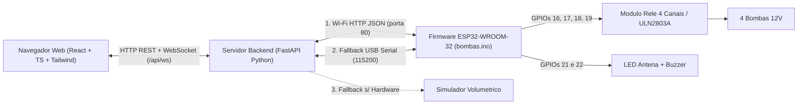

# 🍹 Bartender.OS v2.0 — Bartender Automático com ESP32

Plataforma completa de **coquetelaria automatizada** controlada por microcontrolador **ESP32-WROOM-32**, com backend assíncrono em **FastAPI (Python)** e interface web moderna em **React + TypeScript + Vite + Tailwind CSS**.

O sistema dosa cada ingrediente ao mililitro com base na vazão real calibrada de 4 bombas peristálticas/diafragma de 12V, exibindo o progresso ao vivo no navegador (computador, tablet/totem ou celular) via **WebSockets**.

---

## Sumário

1. [Como o Aplicativo Funciona](#-como-o-aplicativo-funciona)
2. [Arquitetura e Fluxo Interno de um Pedido](#-arquitetura-e-fluxo-interno-de-um-pedido)
3. [Estrutura do Repositório](#-estrutura-do-repositório)
4. [Hardware e Pinagem no ESP32-WROOM-32](#-hardware-e-pinagem-no-esp32-wroom-32)
5. [Guia Completo: Como Fazer Tudo Funcionar do Zero](#-guia-completo-como-fazer-tudo-funcionar-do-zero)
6. [Como Calibrar as Bombas na Prática](#-como-calibrar-as-bombas-na-prática)
7. [Referência de Rotas da API](#-referência-de-rotas-da-api)
8. [Solução de Problemas Comuns (Troubleshooting)](#-solução-de-problemas-comuns-troubleshooting)

---

## ✨ Como o Aplicativo Funciona

A interface web foi projetada como um painel de mixologia interativo dividido em quatro áreas principais:

### 1. Cardápio de Drinks (`Aba Cardápio`)
- Exibe receitas clássicas (*Red Robotics*, *Yellow Web*, *Green Games*, *Mix Basics*) e receitas autorais (*Cyber Tropics*, *Full-Stack RGB*), com filtro por categoria.
- Cada card renderiza um **copo vetorial dinâmico** com as cores e camadas proporcionais dos ingredientes, informando o **volume total (`ml`)** e o **tempo estimado de preparo (`segundos`)** calculados automaticamente a partir da vazão configurada de cada bomba.
- Ao clicar em **Preparar Drink**, o pedido é validado e enviado imediatamente ao ESP32.

### 2. Estúdio "Monte seu Drink" (`Aba Monte seu Drink`)
- Permite criar uma bebida personalizada escolhendo um nome e ajustando controles deslizantes (`sliders` de `5 em 5 ml` ou botões rápidos `+25ml`) para cada uma das **4 bombas**.
- Conforme você altera os mililitros, a ilustração do copo atualiza **em tempo real** o nível de enchimento, as camadas de cor, a porcentagem da capacidade e o tempo estimado.
- Inclui **trava automática de segurança em `450 ml`** (configurável) para evitar que um pedido transborde o copo físico, além de exigir um mínimo de `10 ml`.

### 3. Modal de Preparo em Tempo Real & Parada de Emergência
- Assim que o preparo começa, uma janela acompanha o processo ao vivo via **WebSocket (`/api/ws`)**:
  - Mostra um jato animado da cor do ingrediente que está caindo no copo naquele instante.
  - Exibe a porcentagem (`0%` a `100%`), o tempo decorrido e qual bomba (`GPIO`) está ligada.
  - Possui o botão vermelho **Parada de Emergência (Desligar Bombas)**: se o copo for retirado ou algo sair errado, um clique corta imediatamente os relés no ESP32.

### 4. Painel de Hardware & Calibração (`Ícone ⚙️ no topo direito`)
- Exibe o diagnóstico da conexão e permite alternar entre **4 modos de operação**:
  - **`Auto` (Padrão Recomendado):** Tenta conectar ao ESP32 via **Wi-Fi**; se não encontrar, tenta via **Cabo USB Serial**; se o hardware estiver desligado, aciona automaticamente o **Simulador em Tempo Real** para que você possa testar e demonstrar o site sem erros.
  - **`Apenas Wi-Fi (HTTP)`:** Exige conexão de rede com o ESP32 (`bartender.local` ou IP fixo).
  - **`Apenas USB Serial`:** Comunica exclusivamente pela porta `COM` (ex.: `COM3`, `115200` baud).
  - **`Modo Simulador`:** Simula o tempo real de dosagem de cada bomba sem acionar hardware físico.
- Permite também **editar o nome da bebida** instalada em cada bomba (ex.: trocar *"Maçã Verde"* por *"Curaçau Blue"*) e **ajustar a vazão em `ml/s`**, atualizando automaticamente os cálculos do site e gravando a nova calibração na memória Flash do ESP32.

---

## 🧠 Arquitetura e Fluxo Interno de um Pedido



### Passo a passo técnico do preparo:
1. **Requisição:** O frontend envia `POST /api/dispense/{id}` (receita pronta) ou `POST /api/dispense/custom` (volumes escolhidos pelo usuário).
2. **Controle de Concorrência:** O `ESP32Controller` no FastAPI utiliza um `asyncio.Lock` para garantir que dois pedidos nunca sejam executados ao mesmo tempo (retornando `HTTP 409 Conflict` se já houver bebida em preparo).
3. **Plano de Dosagem:** O backend converte a receita em uma sequência ordenada de etapas no formato compacto `bomba:ml:pausa_ms` (por exemplo: `vermelho:70.0:1500,azul:220.0:0`).
4. **Cálculo Físico no ESP32:** Para cada etapa, o firmware calcula o tempo exato de acionamento da bomba usando a vazão calibrada:
   $$\text{tempo (ms)} = \left(\frac{\text{volume (ml)}}{\text{vazão (ml/s)}}\right) \times 1000$$
5. **Máquina de Estados Não-Bloqueante (`millis()`):** Diferente do código legado de Arduino (que usava `delay()` e congelava o processador), o ESP32 executa um loop contínuo de estados (`STATE_DOSING` → `STATE_PAUSING` → `STATE_MELODY` → `STATE_DONE`). Isso permite que o ESP32 responda a consultas de progresso (`GET /status`) em menos de `5 ms` e execute `POST /stop` instantaneamente.
6. **Finalização Musical:** Ao concluir a última bomba, o ESP32 toca a melodia de vitória no buzzer (`GPIO 22`) piscando o LED da antena (`GPIO 21`) no ritmo das notas e sinaliza `DONE`.

---

## 📂 Estrutura do Repositório

```text
projetobartender/
├── backend/                        # Servidor Python Assíncrono (FastAPI)
│   ├── app/
│   │   ├── main.py                 # Rotas REST, WebSocket (/api/ws) e servidor SPA estático
│   │   ├── esp32_client.py         # Driver híbrido (Wi-Fi HTTP + USB Serial + Simulador)
│   │   ├── catalog.py              # Catálogo de drinks e persistência das 4 bombas
│   │   ├── models.py               # Schemas e validações Pydantic
│   │   └── config.py               # Variáveis de ambiente e caminhos
│   ├── requirements.txt            # Dependências Python
│   └── .env.example                # Exemplo de configuração de ambiente
├── frontend/                       # Aplicação Web Moderna (React 19 + Vite + TS + Tailwind v4)
│   ├── src/
│   │   ├── api/client.ts           # Cliente HTTP tipado para a API FastAPI
│   │   ├── components/
│   │   │   ├── Navbar.tsx          # Barra superior com status ao vivo do ESP32
│   │   │   ├── DrinkCard.tsx       # Card de drink com proporções e tempo estimado
│   │   │   ├── CustomDrinkBuilder.tsx # Estúdio interativo "Monte seu Drink"
│   │   │   ├── GlassArtwork.tsx    # Copo vetorial animado com camadas líquidas e bolhas
│   │   │   ├── PreparationModal.tsx   # Modal de telemetria ao vivo + Parada de Emergência
│   │   │   └── SettingsDrawer.tsx  # Painel lateral de conexão ESP32 e calibração de bombas
│   │   ├── types/bartender.ts      # Interfaces TypeScript compartilhadas
│   │   └── App.tsx                 # Orquestração de estado e conexão WebSocket
│   ├── package.json
│   └── vite.config.ts              # Configuração Vite + Proxy /api e WebSocket para porta 8000
├── bombas/
│   └── bombas.ino                  # Firmware completo para ESP32-WROOM-32 (Wi-Fi + Serial)
├── esquema/                        # Esquemas elétricos originais (KiCad 9 e Fritzing)
├── server.py                       # Atalho de inicialização rápida do servidor FastAPI
└── README.md                       # Documentação completa do projeto
```

---

## 🔌 Hardware e Pinagem no ESP32-WROOM-32

> ⚠️ **Atenção Crítica:** Nos módulos **ESP32-WROOM-32**, os pinos **GPIO 6 a 11** são ligados internamente à memória Flash SPI (usá-los trava o ESP32 em *bootloop*), e o **GPIO 3** é o pino `RX0` da USB Serial. Utilize exatamente a tabela segura abaixo:

| Função / Atuador | Pino Antigo (Arduino UNO) | Novo Pino (ESP32-WROOM-32) | Vazão Padrão |
| :--- | :---: | :---: | :---: |
| **Bomba 1 · Amarela** (Relé IN1) | D2 | **GPIO 16** | `30.5 ml/s` |
| **Bomba 2 · Vermelha** (Relé IN2) | D3 | **GPIO 17** | `32.3 ml/s` |
| **Bomba 3 · Verde** (Relé IN3) | D4 | **GPIO 18** | `32.3 ml/s` |
| **Bomba 4 · Azul / Base** (Relé IN4) | D5 | **GPIO 19** | `35.9 ml/s` |
| **LED Antena / Status** | D6 | **GPIO 21** | — |
| **Buzzer Passivo (Melodia)** | D7 | **GPIO 22** | — |
| **Comunicação Sem Fio** | HC-05 (D12/D13) | **Wi-Fi Nativo do ESP32** | — |

### Cuidados na ligação elétrica:
1. **GND Comum Obrigatório:** Conecte um pino `GND` do ESP32 ao `GND` do módulo relé (ou do `ULN2803A`). Sem o terra compartilhado, os sinais dos GPIOs não acionam as bombas.
2. **Alimentação Separada para as Bombas 12V:** Alimente os motores das bombas com sua fonte/bateria `12V` passando pelos contatos `COM` e `NO` (Normalmente Aberto) dos relés. Alimente a lógica do módulo relé com `5V`.
3. **Tipo de Driver (`RELE_ATIVO_EM_LOW`):**
   - **Módulo Relé Óptico de 4 Canais tradicional:** liga com sinal `LOW`. Mantenha `const bool RELE_ATIVO_EM_LOW = true;` na linha 42 de `bombas/bombas.ino`.
   - **CI Driver Darlington `ULN2803A`:** liga com sinal `HIGH` (`3.3V`). Caso use o `ULN2803A`, mude para `const bool RELE_ATIVO_EM_LOW = false;`.
   - *Proteção contra esguicho no boot:* O firmware pré-carrega o registrador de saída em estado desligado **antes** do `pinMode(..., OUTPUT)`, evitando que as bombas deem um pulso ao energizar o ESP32.

---

## 🚀 Guia Completo: Como Fazer Tudo Funcionar do Zero

### Pré-requisitos no Computador
- **Python 3.10 ou superior** instalado
- **Node.js 18 ou superior** (com `npm`) instalado
- **Arduino IDE 2.x** instalada (para gravar o código no ESP32)

---

### Etapa 1: Gravar o Firmware no ESP32

1. Abra o arquivo **`bombas/bombas.ino`** na **Arduino IDE**.
2. Caso ainda não tenha o suporte a ESP32 na Arduino IDE:
   - Abra o **Boards Manager** (ícone de placas na barra lateral esquerda), pesquise por **`esp32`** e instale **`esp32 by Espressif Systems`**.
   - *(Não é necessário instalar nenhuma biblioteca adicional — todas já são nativas).*
3. Nas linhas **26 e 27** de `bombas.ino`, digite o nome e a senha da sua rede **Wi-Fi 2.4 GHz**:
   ```cpp
   const char* WIFI_SSID     = "NOME_DO_SEU_WIFI_2.4G";
   const char* WIFI_PASSWORD = "SENHA_DO_SEU_WIFI";
   ```
   > **Nota:** Caso o ESP32 não encontre esse Wi-Fi em 10 segundos (ex.: em uma feira ou evento sem roteador), ele cria automaticamente uma rede Wi-Fi própria chamada **`Bartender-ESP32`** (senha **`12345678`**, IP **`192.168.4.1`**)!
4. Conecte o ESP32 ao computador usando um **cabo USB de dados**.
5. Em **Tools → Board → esp32**, selecione **`ESP32 Dev Module`** (ou `DOIT ESP32 DEVKIT V1`).
6. Em **Tools → Port**, selecione a porta `COM` correspondente (ex.: `COM3`, `COM4`).
7. Clique em **Upload (→)**.
   - *Dica:* Se aparecer `Connecting........_____` e não avançar, segure o botão físico **`BOOT`** na placa do ESP32 por 2 segundos até iniciar a gravação.
8. Abra o **Serial Monitor** na velocidade **`115200 baud`** e aperte o botão **`EN` / `RST`** no ESP32. Anote o endereço IP exibido:
   ```text
   === Bartender Automatico ESP32 v2.0 ===
   Wi-Fi conectado! IP: 192.168.1.50
   mDNS ativo: http://bartender.local
   Servidor HTTP pronto na porta 80!
   ```
   *(Se pretende usar conexão via cabo USB Serial em vez de Wi-Fi, **feche o Serial Monitor** após anotar para liberar a porta `COM` para o Python).*

---

### Etapa 2: Instalar as Dependências do Servidor e do Site

Abra um terminal **PowerShell** na pasta `projetobartender/` e execute:

#### 1. Criar ambiente virtual Python e instalar o Backend (FastAPI):
```powershell
python -m venv .venv
.\.venv\Scripts\python -m pip install -r backend/requirements.txt
```

#### 2. Instalar pacotes e gerar o build otimizado do Frontend (React + Vite):
```powershell
cd frontend
npm install
npm run build
cd ..
```

---

### Etapa 3: Iniciar o Aplicativo

#### Opção A — Modo Uso Normal / Produção (1 único comando!)
Com o `npm run build` já feito acima, o próprio FastAPI entrega o site compilado e a API juntos na porta `8000`. Na pasta `projetobartender/`, rode:
```powershell
.\.venv\Scripts\python server.py
```
Agora abra no navegador:
- **Site Principal:** `http://localhost:8000`
- **Documentação Interativa da API (Swagger):** `http://localhost:8000/docs`

#### Opção B — Modo Desenvolvimento (para editar o código React com Hot-Reload)
Use dois terminais abertos em `projetobartender/`:

- **Terminal 1 (Backend na porta 8000):**
  ```powershell
  .\.venv\Scripts\python server.py
  ```
- **Terminal 2 (Vite Dev Server na porta 5173):**
  ```powershell
  cd frontend
  npm run dev
  ```
  Acesse **`http://localhost:5173`** (o Vite redireciona automaticamente `/api` e WebSockets para `localhost:8000`).

---

### Etapa 4: Conectar o Site ao ESP32 e Abrir no Celular

1. No site (`http://localhost:8000`), clique no **ícone de engrenagem (⚙️)** no canto superior direito.
2. Em **Host / IP do ESP32 (Wi-Fi)**, informe o IP anotado no Monitor Serial (ex.: `192.168.1.50`) ou mantenha `bartender.local`.
3. Clique em **Salvar Configuração de Conexão** e depois em **Testar Agora**.
4. O indicador superior ficará **verde (`ESP32 Wi-Fi · 192.168.1.50`)**!
5. **Para pedir drinks pelo celular ou tablet:**
   - Conecte o celular no mesmo Wi-Fi do computador.
   - No PowerShell do PC, rode `ipconfig` e veja o **Endereço IPv4** do seu computador (ex.: `192.168.1.10`).
   - No navegador do celular, acesse **`http://192.168.1.10:8000`** — qualquer pessoa na festa/evento poderá pedir ou montar seu drink e todos verão o progresso ao vivo sincronizado!

---

## 🧪 Como Calibrar as Bombas na Prática

Cada bomba física pode ter uma pequena variação de vazão dependendo do comprimento das mangueiras de silicone e da tensão da fonte:

1. Coloque água limpa na entrada da bomba que deseja calibrar e posicione um **copo medidor graduado** na saída.
2. Com as mangueiras já preenchidas de líquido (sem bolhas de ar), peça no estúdio **Monte seu Drink** exatamente **`100 ml`** apenas daquela bomba.
3. Observe quantos `ml` reais caíram no copo medidor:
   - Se pediu `100 ml` e caíram **`90 ml`**, diminua a vazão configurada em 10% (ex.: de `32.3` para `29.1 ml/s`).
   - Se pediu `100 ml` e caíram **`110 ml`**, aumente a vazão configurada em 10% (ex.: de `32.3` para `35.5 ml/s`).
4. Salve o novo valor em `ml/s` clicando em **OK** ao lado da bomba no painel **⚙️ Hardware ESP32 & Calibração**.

---

## 📡 Referência de Rotas da API

### Backend FastAPI (`http://localhost:8000`)
| Método | Rota | Descrição |
| :---: | :--- | :--- |
| `GET` | `/api/drinks` | Lista todas as receitas com `total_ml` e `estimated_seconds` calculados |
| `GET` | `/api/pumps` | Lista as 4 bombas, GPIOs, bebidas instaladas e vazões (`ml/s`) |
| `PUT` | `/api/pumps/{pump_id}` | Atualiza bebida ou vazão de uma bomba e sincroniza com o ESP32 |
| `POST` | `/api/dispense/{drink_id}` | Inicia o preparo assíncrono de um drink do cardápio |
| `POST` | `/api/dispense/custom` | Inicia o preparo de um drink personalizado (`amarelo`, `vermelho`, `verde`, `azul`) |
| `POST` | `/api/stop` | **Parada de Emergência** imediata (desliga relés e cancela tarefa) |
| `GET` | `/api/status` | Retorna snapshot completo do preparo atual e saúde do hardware |
| `GET / PUT` | `/api/connection` | Testa ou atualiza o modo/endereço de conexão com o ESP32 |
| `WS` | `/api/ws` | Canal WebSocket com atualizações em tempo real do preparo |

### Firmware ESP32 (`http://bartender.local` / `115200` Serial)
| Canal | Comando / Endpoint | Exemplo |
| :---: | :--- | :--- |
| **HTTP** | `GET /status` | Retorna JSON com `state`, `progress`, `current_pump`, `ip`, `rssi` e vazões |
| **HTTP** | `POST /dispense` | `{"name": "Red Robotics", "plan": "vermelho:70:1500,azul:220:0"}` |
| **HTTP** | `POST /stop` | Corta todas as bombas imediatamente e retorna `stopped` |
| **HTTP** | `POST /config/pumps` | `{"amarelo": 30.5, "vermelho": 32.3, "verde": 32.3, "azul": 35.9}` (salva em NVS) |
| **Serial** | `PLAN:<etapas>` | `PLAN:amarelo:50:1200,azul:200:0` (também aceita `RED`, `YELLOW`, `GREEN`, `MIX`, `STOP`, `STATUS`) |

---

## 🛠️ Solução de Problemas Comuns (Troubleshooting)

- **O ESP32 não conecta no meu Wi-Fi:**
  Verifique se a rede configurada em `WIFI_SSID` é **2.4 GHz**. Redes Wi-Fi exclusivamente `5 GHz` não são suportadas pelo rádio do ESP32.
- **`bartender.local` não abre no Windows, mas o IP abre:**
  Algumas redes corporativas ou roteadores bloqueiam pacotes multicast (mDNS). Basta colocar o **endereço IP numérico** do ESP32 (visto no Monitor Serial, ex.: `192.168.1.50`) no painel ⚙️ do site.
- **Erro ao abrir a porta `COM` no modo USB Serial:**
  Feche o **Serial Monitor** da Arduino IDE — o Windows permite apenas um programa conectado à porta Serial por vez.
- **As bombas ligam invertidas (ficam ligadas paradas e desligam no preparo):**
  Inverta a constante `RELE_ATIVO_EM_LOW` (de `true` para `false` ou vice-versa) na linha 42 de `bombas/bombas.ino` e regrave o ESP32, ou verifique se os fios das bombas estão nos bornes **`COM` + `NO` (Normalmente Aberto)** do relé (e não no `NC`).
