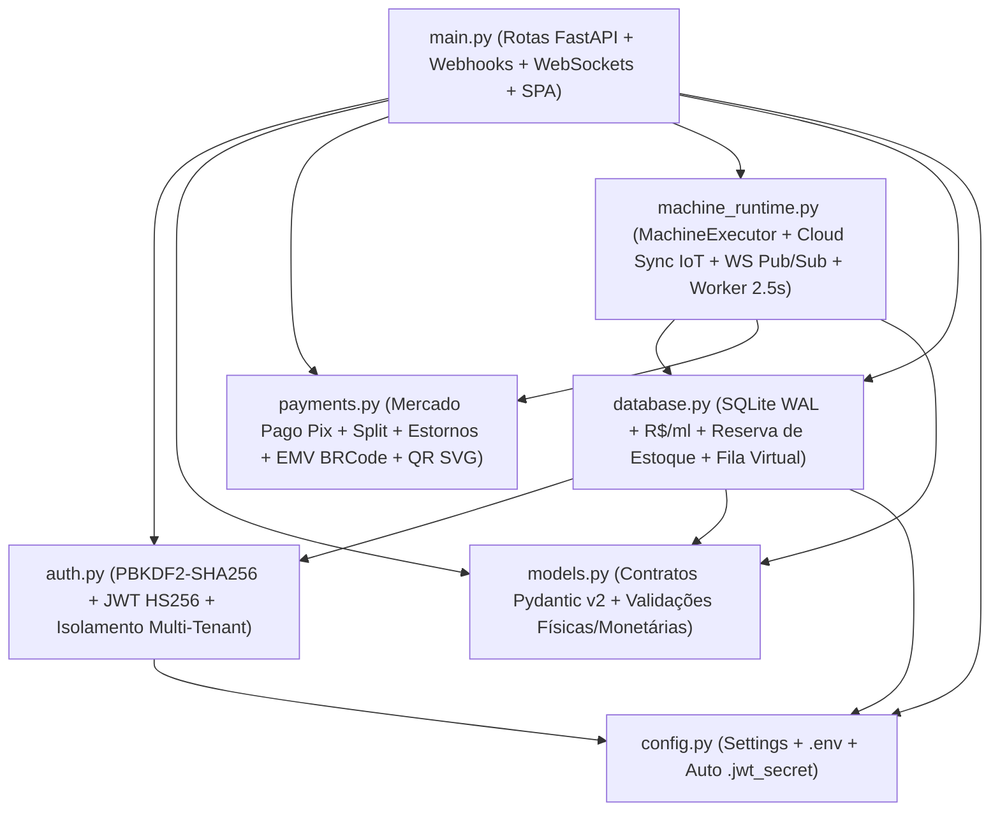
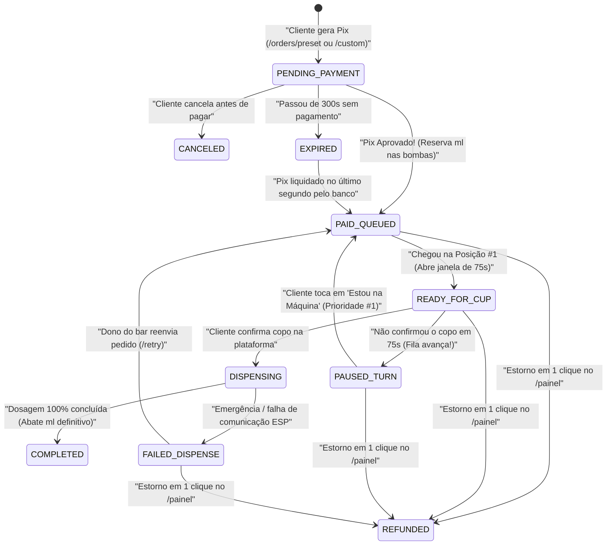

# 🧠 Núcleo da Aplicação Backend (`backend/app/`)

Este pacote contém toda a lógica de negócios, criptografia, contratos de dados, motor financeiro Pix, máquina de estados de fila virtual e orquestração de hardware IoT do **Bartender.OS v3.0**.

---

## 🗺️ Mapa Arquitetural dos Módulos

| Arquivo | Responsabilidade Principal | Destaques Técnicos e Comerciais |
| :--- | :--- | :--- |
| **[`config.py`](./config.py)** | Configurações e segredos | Carrega `.env` e auto-provisiona `.jwt_secret` de 384 bits sem exigir setup manual. |
| **[`auth.py`](./auth.py)** | Autenticação e RBAC | Hash `PBKDF2-HMAC-SHA256` (`200.000` iterações), JWT `HS256` nativo com `hmac.compare_digest` e `resolve_target_bar_id` anti-IDOR entre bares. |
| **[`models.py`](./models.py)** | Esquemas Pydantic v2 | Validação estrita em centavos inteiros (`*_cents`), limites físicos de copo/bombas e tipagem dos 10 estados de pedido. |
| **[`database.py`](./database.py)** | Persistência e Regras de Negócio | SQLite `WAL` com `RLock`, cálculo de `R$/ml` com perda (`loss_pct`), reserva de estoque em trânsito e fila com janela de turno de `75s`. |
| **[`payments.py`](./payments.py)** | Pagamentos Pix e QR Codes | API oficial Mercado Pago (`/v1/payments` e `/refunds`), Split `application_fee` com fallback limpo, gerador EMV BRCode `CRC16-CCITT` e SVG via `segno`. |
| **[`machine_runtime.py`](./machine_runtime.py)** | Runtime IoT e Tempo Real | `MachineExecutor` por máquina (`cloud_iot`, `wifi`, `serial`, `simulator`), broadcast WebSocket e loop global de conciliação/expiração. |
| **[`network_discovery.py`](./network_discovery.py)** | Descoberta Zero-Config & Provisionamento | Inspeciona Wi-Fi ativo (`netsh wlan`), resolve redes irmãs `5 GHz -> 2.4 GHz`, sincroniza `bombas/secrets.h` (Multi-WiFi), descobre o ESP em 4 camadas (`UDP :4210`, `Cache/mDNS`, `ARP`, `Sweep /24`), faz ponte SoftAP e detecta portas USB Serial (`CH340`/`CP210x`). |
| **[`main.py`](./main.py)** | Controlador HTTP/WS/SPA | Exposição de todos os endpoints REST, Webhook Pix, `/api/iot/{slug}/sync`, `/api/bar/machines/{id}/discover`, WebSocket e entrega segura do bundle React. |

---

## 🔄 Máquina de Estados do Pedido & Fila Anti-Desperdício

Um dos maiores diferenciais comerciais do Bartender.OS v3.0 é desacoplar o **momento do pagamento** do **momento do acionamento das bombas**. Dezenas de clientes podem pagar simultaneamente no 4G sem risco de derramar bebida no balcão vazio:

### Proteções Críticas Anti-Fraude e Anti-Prejuízo Implementadas:
- **Reserva de Estoque em Trânsito (`_get_reserved_ml_by_pump`):** Assim que um pedido entra em `PAID_QUEUED`, seus mililitros já são descontados do `available_ml` exibido aos próximos clientes — impossibilitando vender duas vezes o final de uma garrafa!
- **Vinculação de Sessão (`customer_session_id`):** Um cliente na posição `#2` (`PAID_QUEUED`) recebe bloqueio `HTTP 409` se tentar acionar a máquina antes do `#1`, e outro celular recebe `HTTP 403` se tentar comandar um `order_id` alheio.
- **Proteção contra Queda de Hardware na Partida:** Se a máquina perder conexão exatamente no clique de confirmação do copo, `confirm_cup_and_start_dispense` reverte o status de volta para `READY_FOR_CUP` dentro de um bloco transacional, preservando integralmente o crédito pago pelo consumidor.

---

## 📡 Catálogo Completo de Endpoints da API

### 1. Autenticação (`/api/auth`)
| Método | Rota | Acesso | Descrição |
| :--- | :--- | :--- | :--- |
| `POST` | `/api/auth/login` | Público | Autentica `superadmin` ou `bar_owner` e emite Bearer Token JWT `HS256`. |
| `GET` | `/api/auth/me` | JWT | Retorna o perfil autenticado (`sub`, `email`, `role`, `bar_id`, `bar_name`). |

### 2. Autoatendimento Público via QR Code & Pix (`/api/public`)
| Método | Rota | Acesso | Descrição |
| :--- | :--- | :--- | :--- |
| `GET` | `/api/public/machines` | Público | Lista máquinas públicas de estabelecimentos ativos. |
| `GET` | `/api/public/m/{machine_slug}` | Público | Carrega cardápio calculado, 4 bombas com estoque vivo, fila e pedido ativo da sessão. |
| `GET` | `/api/public/m/{machine_slug}/qr.svg` | Público | Baixa arte vetorial `.svg` do QR Code da máquina pronta para gráfica/acrílico. |
| `POST` | `/api/public/m/{machine_slug}/orders/preset` | Público | Cria pedido de drink do cardápio e gera cobrança Pix imediata. |
| `POST` | `/api/public/m/{machine_slug}/orders/custom` | Público | Cria pedido personalizado em `ml` (*Monte seu Drink*) e gera cobrança Pix. |
| `GET` | `/api/public/orders/{order_id}` | Público | Consulta status do pedido, timers e força checagem imediata no Mercado Pago se pendente. |
| `POST` | `/api/public/orders/{order_id}/simulate-pay` | Público (Modo Sim) | Aprova instantaneamente o Pix quando o bar opera em `payment_provider="simulated"`. |
| `POST` | `/api/public/orders/{order_id}/cancel` | Sessão Cliente | Cancela cobrança `PENDING_PAYMENT` ainda não paga. |
| `POST` | `/api/public/orders/{order_id}/resume-turn` | Sessão Cliente | Retoma vez prioritária de pedido em `PAUSED_TURN` ou renova janela de `75s`. |
| `POST` | `/api/public/orders/{order_id}/confirm-cup-and-dispense` | Sessão Cliente | Exige `cup_on_platform_confirmed=true` na posição `#1` e inicia as bombas físicas/simuladas. |

### 3. Integrações Externas: Webhook Pix, Cloud IoT & WebSocket
| Protocolo | Rota | Autenticação | Descrição |
| :--- | :--- | :--- | :--- |
| `POST` | `/api/webhooks/mercadopago/{bar_id}` | Verificação na API MP | Recebe notificação Pix, confere autenticidade em `/v1/payments/{id}` e libera fila + WS. |
| `POST` | `/api/iot/{machine_slug}/sync` | Header `X-Machine-Token` | Sincronização a cada `450ms–800ms` da placa `ESP8266`/`ESP32` no Wi-Fi do bar. |
| `WS` | `/api/ws/machines/{machine_slug}` | Público | Stream push de `MachineRealtimeSnapshot` (progresso de bombas, fila e estoque). |

### 4. Painel do Dono do Bar (`/api/bar` — Isolado por `bar_id`)
| Método | Rota | Descrição |
| :--- | :--- | :--- |
| `GET` / `PUT` | `/api/bar/settings` | Lê (com token mascarado) ou atualiza provedor Pix, `Access Token` Mercado Pago e senha. |
| `GET` / `POST` | `/api/bar/bottles` | Lista ou cria garrafas com custo, `%` de perda e `price_per_liter_cents` (`R$/ml`). |
| `PUT` / `DELETE` | `/api/bar/bottles/{bottle_id}` | Edita ou exclui garrafa (atualizando vitrines conectadas via WebSocket). |
| `GET` / `POST` | `/api/bar/drinks` | Lista ou cria receitas do cardápio (`auto_ml` ou `fixed`). |
| `PUT` / `DELETE` | `/api/bar/drinks/{drink_id}` | Edita ou exclui definitivamente qualquer receita do bar. |
| `GET` / `POST` | `/api/bar/machines` | Lista máquinas (com credenciais IoT) ou provisiona nova estação física no bar. |
| `PUT` | `/api/bar/machines/{machine_id}` | Configura taxa de copo, pedido mínimo, volume máximo `ml` e modo de transporte. |
| `PUT` | `/api/bar/machines/{machine_id}/pumps/{pump_id}` | Espeta garrafa na bomba, ajusta reserva ou calibra vazão `ml/s` (com sync OTA p/ ESP). |
| `POST` | `/api/bar/machines/{machine_id}/pumps/{pump_id}/refill` | Reabastece 100% do nível da garrafa em 1 clique após troca física no balcão. |
| `POST` | `/api/bar/machines/{machine_id}/stop` | Parada de Emergência remota instantânea das 4 bombas. |
| `GET` | `/api/bar/orders` / `/api/bar/analytics` | Histórico auditável de pedidos e DRE em tempo real (Bruto, CMV, Split e Lucro Líquido). |
| `POST` | `/api/bar/orders/{order_id}/refund` | Estorna o Pix no Mercado Pago (`/refunds`) e remove o pedido da fila. |
| `POST` | `/api/bar/orders/{order_id}/retry` | Reinsere pedido `FAILED_DISPENSE` na fila sem cobrar novamente o cliente. |

### 5. Painel Executivo Super-Admin (`/api/superadmin` — Exclusivo `role="superadmin"`)
| Método | Rota | Descrição |
| :--- | :--- | :--- |
| `GET` | `/api/superadmin/overview` | GMV total da plataforma, comissões de split acumuladas e performance por bar. |
| `POST` | `/api/superadmin/bars` | Onboarding B2B: cria novo bar cliente + usuário proprietário + 1ª máquina IoT pronta. |
| `PUT` / `DELETE` | `/api/superadmin/bars/{bar_id}` | Ajusta `%` de comissão SaaS, credenciais, ativa/suspende ou remove o estabelecimento. |
