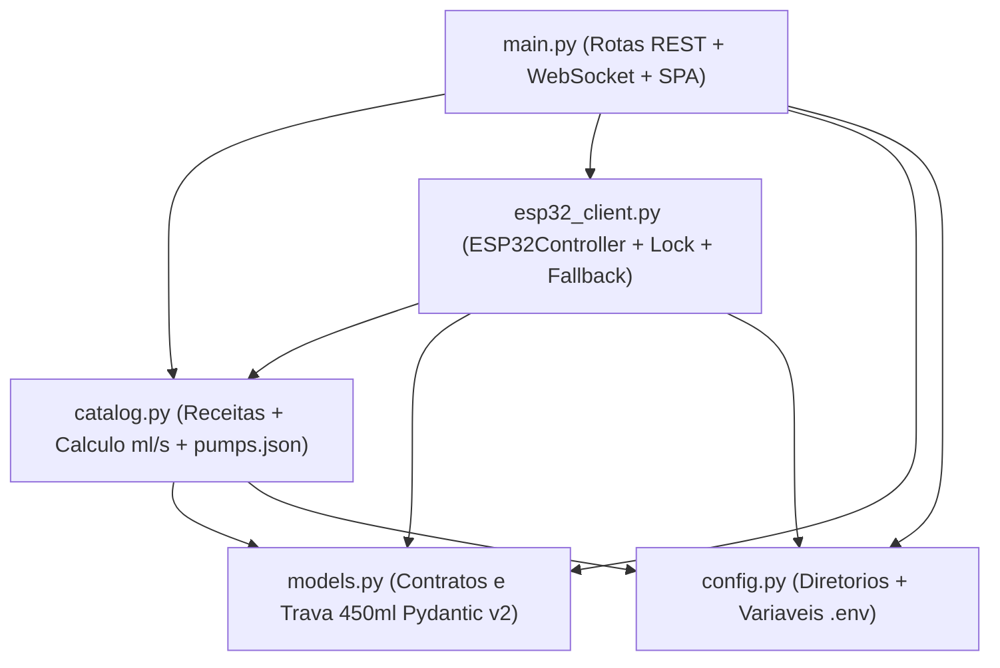
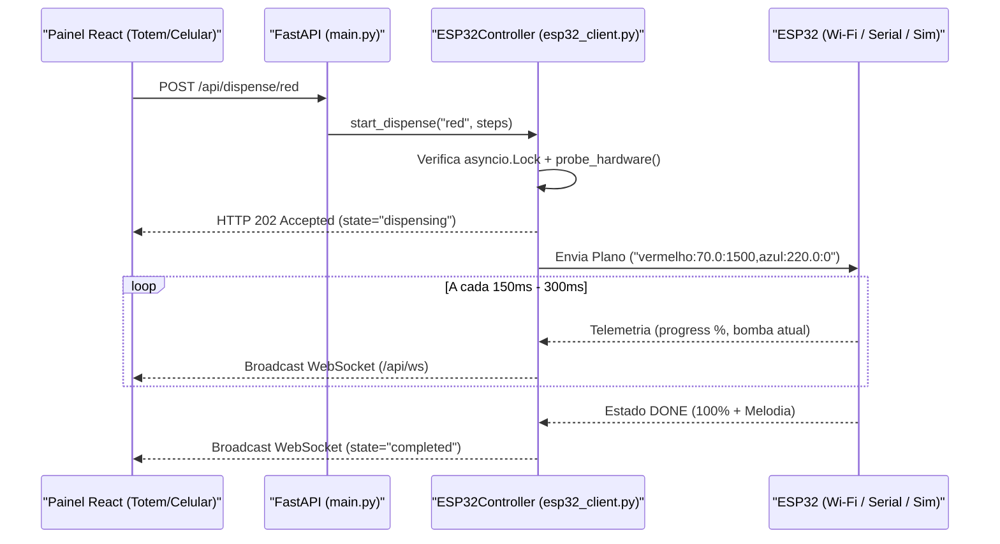

# ⚙️ Núcleo da Aplicação FastAPI (`backend/app/`)

Camada de domínio, controle de concorrência, validação ciberfísica e comunicação assíncrona multi-transporte com o microcontrolador **ESP32 / ESP8266**.

---

## 💼 Diferenciais de Engenharia para Pré-Venda Técnica

Quando um cliente corporativo ou produtor de eventos avalia uma máquina de bebidas automatizada, três perguntas técnicas sempre surgem: **"E se duas pessoas clicarem juntas?"**, **"E se o Wi-Fi da festa cair?"** e **"E se tirarem o copo no meio?"**. O pacote `backend/app/` resolve todas na raiz:

1. **Exclusão Mútua Atômica (`asyncio.Lock`):**
   Mesmo que 30 convidados escaneiem o QR Code do bar e cliquem em *"Preparar Drink"* no mesmo instante, o `ESP32Controller` garante que apenas o primeiro pedido adquira o lock físico. Os demais recebem `HTTP 409 Conflict` instantâneo com aviso amigável na tela, evitando mistura indevida de receitas.
2. **Fallback Triplo Transparente (`Wi-Fi → USB Serial → Simulador`):**
   No modo `auto`, o método `probe_hardware()` testa a saúde do ESP32 antes de cada preparo:
   - Tenta IP em cache e hostname mDNS via `httpx.AsyncClient(trust_env=False)` (imune a proxies corporativos);
   - Em caso de falha de RF, chaveia sem intervenção humana para comunicação direta via cabo USB (`pyserial`);
   - Em apresentações comerciais sem a bancada física, executa o **Simulador Volumétrico** fiel ao décimo de segundo.
3. **Streaming WebSocket com Controle de *Backpressure* (`maxsize=32`):**
   Cada tela conectada em `/api/ws` recebe sua própria fila isolada (`asyncio.Queue(maxsize=32)`). Se o celular de um convidado oscilar na borda do Wi-Fi, os quadros antigos são descartados sem jamais atrasar a telemetria do totem principal nem vazar memória RAM.

---

## 🧩 Arquitetura Interna dos Módulos

### Responsabilidade de Cada Arquivo

| Arquivo | Papel Detalhado |
| :--- | :--- |
| **`config.py`** | Resolve caminhos multiplataforma (`BASE_DIR`, `DATA_DIR`, `FRONTEND_DIST_DIR`) e carrega a classe singleton `Settings` a partir do `.env`. |
| **`models.py`** | Define os contratos rigorosos Pydantic (`PumpConfig`, `DoseStep`, `DrinkRecipe`, `CustomDrinkRequest`, `PreparationStatus`, `HardwareHealth`, `SystemSnapshot`), aplicando trava de volume total entre `10 ml` e `450 ml`. |
| **`catalog.py`** | Mantém as 4 bombas padrão (`GPIOs 16, 17, 18, 19`), o catálogo de 6 receitas tropicais e a função `compute_recipe_metrics()`, que recalcula `total_ml` e `estimated_seconds` sempre que uma vazão muda. |
| **`esp32_client.py`** | Implementa o singleton `esp32_controller` com pub/sub (`subscribe`/`_broadcast`), codificador de planos (`bomba:ml:pausa_ms`), sincronização NVS (`sync_pump_rates_to_esp32`), `emergency_stop()` e os 3 motores de execução (`_execute_wifi`, `_execute_serial`, `_execute_simulator`). |
| **`network_discovery.py`** | Motor Zero-Config de descoberta de rede: inspeciona Wi-Fi ativo (`netsh wlan`), resolve redes irmãs `5 GHz -> 2.4 GHz`, sincroniza `bombas/secrets.h` (Multi-WiFi), localiza o ESP em 4 camadas (`UDP :4210`, `Cache/mDNS/SoftAP`, `ARP`, `Sweep /24`), faz ponte SoftAP e detecta portas USB Serial (`CH340`/`CP210x`/`FTDI`). |
| **`main.py`** | Instancia o app FastAPI com `lifespan`, CORS, endpoints `/api/*` (incluindo `/api/network` e `/api/network/sync`), canal `/api/ws` e servidor estático seguro (`serve_spa` com verificação anti-*Path Traversal* `target.is_relative_to(dist_root)`). |

---

## 🔄 Sequência Completa de um Pedido até o Copo

