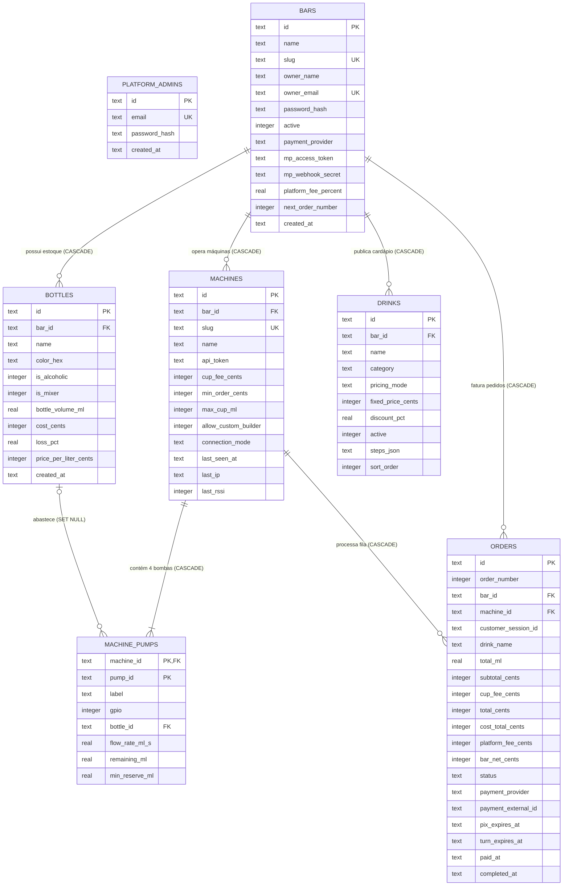

# 🗄️ Camada de Dados, Segredos Locais & Multi-Tenancy (`backend/data/`)

Este diretório armazena os artefatos persistentes gerados automaticamente pelo **Bartender.OS v3.0** em tempo de execução. Por conter dados financeiros, hashes de credenciais e chaves criptográficas de sessão, seus arquivos binários/secretos **não são versionados no Git**.

---

## 📦 Arquivos Gerados Automaticamente nesta Pasta

| Arquivo | Criado em | Função Técnica e Segurança |
| :--- | :--- | :--- |
| `bartender_v3.db` *(+ `-wal` / `-shm`)* | `database.init_db()` | Banco relacional **SQLite 3** operando em modo **`WAL` (*Write-Ahead Logging*)** com `PRAGMA foreign_keys = ON`. Suporta leituras simultâneas de cardápio enquanto grava pagamentos Pix e batimentos IoT com atomicidade `ACID`. |
| `.jwt_secret` | `config._load_or_create_jwt_secret()` | Chave criptográfica URL-safe de `48 bytes` (`384 bits` de entropia) gerada via `secrets.token_urlsafe(48)` no primeiro boot caso `JWT_SECRET` não esteja definido no `.env`. Garante que os logins dos donos de bares sobrevivam a reinícios do servidor. |

> [!CAUTION]
> **Regra de Segurança em Produção:** Nunca compartilhe nem faça commit de `bartender_v3.db` ou `.jwt_secret`. A tabela `bars` armazena o `mp_access_token` de recebimento Pix de cada estabelecimento cliente, e `.jwt_secret` assina os tokens de autenticação da plataforma.

---

## 🏛️ Modelagem Relacional Multi-Tenant (ERD)

Todo o isolamento lógico entre bares concorrentes é garantido pela chave estrangeira obrigatória `bar_id` com integridade referencial em cascata (`ON DELETE CASCADE`):



### Índices de Alta Performance para Operação Noturna de Alto Giro:
1. `idx_orders_machine_status (machine_id, status)`: Acelera em `O(log N)` o cálculo da fila virtual, reserva de mililitros em trânsito e avanço de turnos a cada `2.5s`.
2. `idx_orders_bar_created (bar_id, created_at DESC)`: Garante carregamento instantâneo do histórico de vendas e DRE no painel `/painel`.
3. `idx_orders_session (machine_id, customer_session_id)`: Restaura imediatamente o pedido ativo quando o cliente retorna do aplicativo do banco para o navegador 4G.

---

## 💾 Como Fazer Backup Seguro (Zero Downtime)

Como o banco roda em modo **SQLite `WAL`**, durante a operação podem existir temporariamente os arquivos auxiliares `bartender_v3.db-wal` e `bartender_v3.db-shm`. Para gerar um arquivo único consistente de backup com o bar em pleno funcionamento, utilize a API nativa de backup online do próprio Python:

```powershell
.\.venv\Scripts\python.exe -c "import sqlite3; src=sqlite3.connect('backend/data/bartender_v3.db'); dst=sqlite3.connect('backup_bartender_v3.db'); src.backup(dst); dst.close(); src.close(); print('Backup concluido com sucesso!')"
```

Para restaurar em outro servidor, basta copiar `backup_bartender_v3.db` para `backend/data/bartender_v3.db` (com o processo `server.py` parado) — todo o histórico multi-bares, receitas, garrafas e tokens IoT das placas ESP voltarão intactos!
