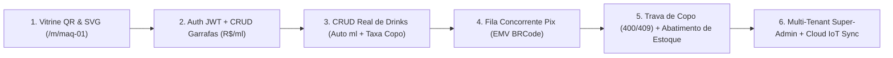

# 🧪 Suíte Automatizada de Testes SaaS & Homologação Comercial (`backend/tests/`)

A suíte [`test_v3_saas.py`](./test_v3_saas.py) valida ponta a ponta (E2E) toda a jornada crítica de geração de receita, contabilidade em centavos, concorrência de fila, trava física anti-desperdício e isolamento multi-tenant do **Bartender.OS v3.0**.

---

## 🛡️ Por Que Esta Suíte Garante Confiabilidade Comercial em Bares Reais?

Em uma operação noturna movimentada, um erro de arredondamento, uma condição de corrida na fila ou o acionamento de uma bomba sem copo significam prejuízo imediato. Os testes automatizados rodam sobre um banco **SQLite real descartável (`tmp_path / "test_v3.db"`)** acoplado ao `TestClient` completo do FastAPI (incluindo `lifespan` e simulador cronométrico real), certificando **6 pilares inegociáveis**:



| Etapa Auditada | Regra de Negócio e Segurança Verificada | Resultado Exigido |
| :--- | :--- | :--- |
| **1. Contexto Público & Arte QR** | Leitura anônima de `/api/public/m/maq-01` e geração vetorial `/qr.svg`. | `4` bombas ativas, `4` drinks iniciais e `Content-Type: image/svg+xml`. |
| **2. Engenharia de Garrafas (`R$/ml`)** | Criação, edição e exclusão de insumo (`1000 ml`, `5%` de perda, `R$ 200,00/L`). | Volume útil calculado em `950.0 ml` e dose de `50 ml` cravada em `R$ 10,00` (`1000` centavos). |
| **3. CRUD Completo de Receitas** | Exclusão real de drink existente e criação de receita autoral em modo `auto_ml`. | `50 ml` (`R$ 0,13/ml`) + `150 ml` (`R$ 0,018/ml`) + copo (`R$ 1,50`) = **`R$ 10,70` (`1070` centavos)**. |
| **4. Pagamento Pix Simultâneo** | Cliente A (*Mix Personalizado*, `R$ 9,30`) e Cliente B (*Preset*) geram e pagam Pix juntos. | Payload EMV BRCode válido (`000201...`), Cliente A em `READY_FOR_CUP` (`#1`) e Cliente B em `PAID_QUEUED` (`#2`). |
| **5. Trava Anti-Desperdício & Anti-Fura-Fila** | Tentativa de servir sem confirmar copo (`cup_on_platform_confirmed=False`) e tentativa do `#2` furar a vez do `#1`. | Bloqueios imediatos **`HTTP 400`** (sem copo) e **`HTTP 409`** (fora da vez); após dosagem do `#1`, abate `50 ml` da bomba (`750 -> 700 ml`) e promove `#2` automaticamente! |
| **6. Multi-Tenancy & Cloud IoT** | Super-Admin cria 2º bar (`Quiosque Praia Clube`, split `6%`) + `ESP32` sincroniza via `/api/iot/maq-piscina-01/sync`. | Isolamento total de credenciais e resposta `200 OK` (`command="none"`) autenticada com `X-Machine-Token`. |

---

## ▶️ Como Executar os Testes

A partir da pasta `projetobartender-v3/`, execute no PowerShell:

```powershell
.\.venv\Scripts\python.exe -m pytest backend/tests -v
```

> [!NOTE]
> **Isolamento Garantido:** A suíte sobrescreve `BARTENDER_DB_PATH` para um diretório temporário do sistema operacional (`pytest tmp_path`), portanto você pode rodar os testes a qualquer momento **sem jamais alterar ou apagar** os dados reais de `backend/data/bartender_v3.db`.
