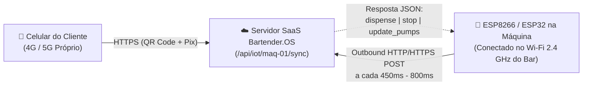

# 🤖 Firmware Comercial Híbrido IoT (`bombas/bombas.ino`)

Firmware embarcado C++ de nível comercial com **código-fonte único** compatível tanto com **`ESP8266 NodeMCU (ESP-12E)`** quanto com **`ESP32-WROOM-32`**, responsável pelo controle milimétrico das 4 bombas 12V, sinalização luminosa/sonora e sincronização contínua com a nuvem SaaS.

---

## 🏆 O Diferencial Comercial Matador: Arquitetura Cloud Sync Outbound

Na maioria das máquinas automatizadas amadoras, o bar precisa manter um computador/notebook ligado atrás do balcão ou contratar um técnico de redes para abrir portas (`Port Forwarding` / IP Fixo) no roteador da operadora — algo inviável na internet comum de bares (quase sempre atrás de **CGNAT**).

No **Bartender.OS v3.0**, invertemos completamente o sentido da conexão:



### Vantagens Diretas para Venda e Escala em Franquias:
1. **Zero Computador no Bar:** Basta ligar a máquina na tomada; a placa conecta sozinha no Wi-Fi `2.4 GHz` existente do estabelecimento.
2. **Zero Abertura de Portas / NAT / VPN:** Como o `ESP` inicia todas as conexões de saída (`HTTP POST`), funciona instantaneamente em fibra comum, roteador doméstico ou modem 4G de evento.
3. **Cliente Não Pede Senha de Wi-Fi:** O consumidor escaneia o adesivo QR Code usando seu próprio 4G/5G, paga o Pix no banco e assiste à barra de progresso subir em tempo real enquanto o `ESP` reporta o preparo pela rede interna do bar!
4. **Calibração Remota OTA em Flash (`update_pumps`):** O dono do bar ajusta a vazão (`ml/s`) de qualquer bomba pelo navegador (`/painel`) e a placa grava automaticamente os novos valores na `EEPROM` (`ESP8266`) ou `Preferences NVS` (`ESP32`), sobrevivendo a quedas de luz.

---

## ⚡ Engenharia de Precisão Volumétrica & Segurança Elétrica

1. **Boot Anti-Glitch (Zero Disparo Acidental na Energização):**
   - No `setup()`, antes mesmo de chamar `pinMode(pin, OUTPUT)`, o firmware pré-carrega o registrador de saída com `nivelDesligado()` (`HIGH` para módulos relé ativos em `LOW`) e utiliza exclusivamente GPIOs livres de *boot strapping*, evitando que as bombas esguichem bebida quando a energia do bar oscila.
2. **Interlock Hidráulico e Elétrico (`ligarBomba`):**
   - Apenas **uma bomba por vez** é energizada, reduzindo em `75%` a corrente de pico exigida da fonte `12V` e garantindo camadas visuais limpas no copo com pausas configuráveis (`pauseMs`).
3. **Janela de Guarda Anti-Jitter de `450ms` (`sincronizarNuvemIoT`):**
   - Máquina de estados 100% não-bloqueante baseada em `millis()` (zero `delay()` durante dosagem).
   - Se faltar menos de `450ms` para encerrar o tempo calculado de uma bomba (`plan[currentStep].pourMs <= elapsedStep + 450UL`), o firmware **adia o batimento HTTP** até desligar o relé no milissegundo exato — impedindo que uma oscilação de Wi-Fi sirva destilado a mais!

---

## 📌 Tabela Oficial de Pinagem Segura (ESP8266 vs ESP32)

| Canal / Função | Chave SaaS | Pino `ESP8266 NodeMCU` | Pino `ESP32-WROOM-32` | Vazão Padrão Inicial |
| :--- | :--- | :--- | :--- | :--- |
| **Bomba 1 · Amarela** | `amarelo` | `D1` (`GPIO 5`) | `GPIO 16` | `30.5 ml/s` |
| **Bomba 2 · Vermelha** | `vermelho` | `D2` (`GPIO 4`) | `GPIO 17` | `32.3 ml/s` |
| **Bomba 3 · Verde** | `verde` | `D5` (`GPIO 14`) | `GPIO 18` | `32.3 ml/s` |
| **Bomba 4 · Azul (Base)** | `azul` | `D6` (`GPIO 12`) | `GPIO 19` | `35.9 ml/s` |
| **LED de Status** | — | `D0` (`GPIO 16`) | `GPIO 21` | Indicador visual de preparo |
| **Buzzer Piezoelétrico** | — | `D7` (`GPIO 13`) | `GPIO 22` | Melodia de drink finalizado |

> [!IMPORTANT]
> **Polaridade do Estágio de Potência (`RELE_ATIVO_EM_LOW`):**
> - Módulos comerciais de **4 Relés com Optoacoplador** acionam em nível lógico `LOW` (`RELE_ATIVO_EM_LOW = true`, padrão de fábrica).
> - Caso utilize a placa dedicada com array Darlington **`ULN2803A`** (ver [`../esquema/README.md`](../esquema/README.md)) ou MOSFETs N-Channel, altere `const bool RELE_ATIVO_EM_LOW = false;` na linha 88 de [`bombas.ino`](./bombas.ino).

---

## 🛠️ Passo a Passo de Gravação (Provisionamento de Nova Máquina)

1. Copie [`secrets.example.h`](./secrets.example.h) para `bombas/secrets.h` (este arquivo já está protegido no `.gitignore`).
2. Acesse o **Painel do Dono do Bar (`/painel`)** → aba **Máquinas, Bombas & QR Code** → clique em **"Ver credenciais Wi-Fi IoT"** na máquina desejada.
3. Preencha seu `bombas/secrets.h`:
   ```cpp
   #define SECRET_WIFI_SSID       "NomeDoWifiDoBar_2.4G"
   #define SECRET_WIFI_PASSWORD   "SenhaDoWifiDoBar"
   #define SECRET_API_TOKEN       "iot_xxxxxxxx..."
   #define SECRET_CLOUD_SYNC_URL  "https://seu-dominio.com.br/api/iot/maq-01/sync"
   ```
4. Abra `bombas/bombas.ino` na **Arduino IDE 2.x**, selecione a placa (`NodeMCU 1.0 (ESP-12E Module)` ou `ESP32 Dev Module`) e clique em **Upload**.
5. Em menos de 5 segundos após reiniciar, o indicador da máquina no `/painel` ficará **Verde Online** exibindo o IP local e a intensidade de sinal Wi-Fi (`RSSI dBm`)!

---

## 🔌 Modos Secundários de Contingência (LAN HTTP & USB Serial)

Além do Cloud Sync principal, o mesmo firmware mantém ativos simultaneamente dois canais locais de contingência:
- **API HTTP LAN (`porta 80` + mDNS `http://bartender.local`):**
  - `GET /status`: Telemetria JSON instantânea.
  - `POST /dispense` *(Header `X-Bartender-Token`)*: Aceita `{"name":"Drink","plan":"vermelho:70:1500,azul:220:0"}`.
  - `POST /stop` *(Header `X-Bartender-Token`)*: Parada de emergência imediata.
  - `POST /config/pumps` *(Header `X-Bartender-Token`)*: Atualiza calibração `ml/s` na Flash.
- **Protocolo USB Serial (`115200 baud`):**
  - Envie `STATUS`, `STOP`, `PLAN:amarelo:50:1200,azul:150:0` ou atalhos de bancada (`RED`, `YELLOW`, `GREEN`, `MIX`) e receba eventos `START:...`, `PROGRESS:<pct>:<bomba>`, `DONE` ou `STOPPED`.
