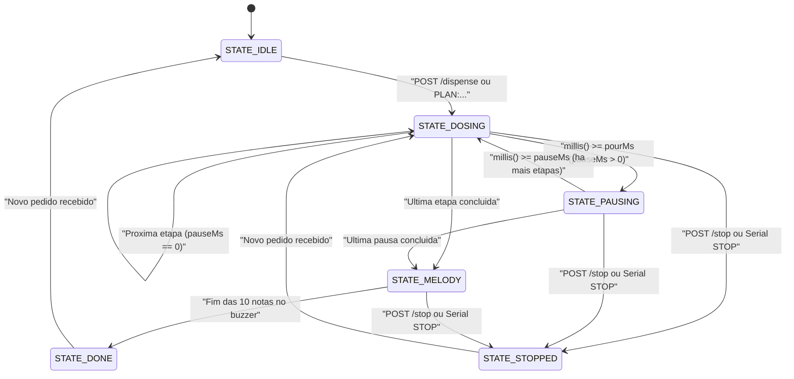

# 🤖 Firmware Embarcado de Tempo Real (`bombas/`)

Firmware C++ híbrido de alta confiabilidade (**`bombas.ino`**) compatível nativamente tanto com **ESP32-WROOM-32** quanto com **ESP8266 NodeMCU**, responsável pelo acionamento determinístico das 4 bombas dosadoras de 12V, sinalização luminosa e melodia sonora de finalização.

---

## 💼 Diferenciais de Engenharia Embarcada (Argumentos de Confiabilidade & Segurança)

Projetos amadores de automação com Arduino costumam usar a função `delay(5000)` para manter uma bomba ligada por 5 segundos — o que **congela completamente o processador**, impedindo cancelar um pedido em caso de acidente ou consultar a porcentagem do preparo. O firmware do **Bartender.OS v2.0** foi arquitetado segundo padrões industriais de sistemas embarcados:

1. **Máquina de Estados 100% Não-Bloqueante (`millis()`):**
   Todo o fluxo (`STATE_IDLE` → `STATE_DOSING` → `STATE_PAUSING` → `STATE_MELODY` → `STATE_DONE` / `STATE_STOPPED`) roda de forma cooperativa em microssegundos. Enquanto uma bomba dosa líquido, o ESP32 continua respondendo `GET /status` em **`< 5 ms`** e atende uma **Parada de Emergência (`POST /stop` ou `STOP\n`) instantaneamente**.
2. **Proteção Elétrica Anti-Esguicho no Boot:**
   Módulos relé ópticos tradicionais acionam em nível lógico `LOW` (`0V`). Ao ligar um microcontrolador comum, os pinos podem piscar brevemente em `LOW` e esguichar bebida no balcão sem ninguém pedir. No `setup()`, nosso firmware **pré-carrega o registrador de saída em estado desligado (`HIGH`) antes mesmo de configurar `pinMode(pin, OUTPUT)`**, garantindo partida limpa e seca.
3. **Intertravamento de Potência por Software (`ligarBomba`):**
   Antes de energizar qualquer bomba, o firmware força o desligamento das outras três (`desligarTodasBombas()`). Isso garante que apenas **1 motor DC parta por vez**, reduzindo drasticamente picos de corrente (*inrush current*) na fonte chaveada 12V e prolongando a vida útil dos contatos dos relés.
4. **Modo Feira / Evento sem Roteador (*SoftAP Fallback* Automático):**
   Se o Wi-Fi configurado não responder em até `10 segundos` ao ligar a máquina, o ESP32 cria sozinho sua própria rede Wi-Fi protegida (**`Bartender-ESP32`**, IP fixo **`192.168.4.1`**) + anúncio **mDNS (`http://bartender.local`)**.
5. **Calibração Persistente em Memória Flash (NVS / EEPROM):**
   As vazões reais (`ml/s`) enviadas pelo painel web em `POST /config/pumps` são salvas na partição não-volátil **NVS (`Preferences`)** no ESP32 (ou **EEPROM com assinatura mágica `0xBA7E2026`** no ESP8266), sobrevivendo a desligamentos e quedas de energia.

---

## 📂 Arquivos Desta Pasta

| Arquivo / Pasta | Versionado? | Descrição |
| :--- | :---: | :--- |
| **`bombas.ino`** | ✅ Sim | Código-fonte completo do firmware híbrido (Wi-Fi HTTP JSON + USB Serial + Máquina de Estados + Buzzer). |
| **`secrets.example.h`** | ✅ Sim | Template público e documentado para configuração de Wi-Fi 2.4 GHz, rede reserva SoftAP e token HTTP. |
| **`secrets.h`** | 🔒 **Não** (`.gitignore`) | Arquivo privado local contendo o SSID/senha reais da instalação (nunca deve ser commitado). |
| **`build/`** | Artefatos | Binários compilados (`.bin`, `.elf`, `partitions.bin`) gerados para gravação rápida em placas ESP32. |

---

## 🔄 Diagrama da Máquina de Estados (`atualizarMaquinaEstados`)

---

## 📐 Equação Volumétrica e Pinagem Multi-Placa

Ao receber um plano como `"vermelho:70.0:1500,azul:220.0:0"`, a função `parsePlanString()` calcula o tempo exato de cada pulso em milissegundos usando a vazão calibrada `flowMlPerSec` daquela bomba:

$$\text{pourMs} = \left\lfloor \left(\frac{\text{ml}}{\text{flowMlPerSec}}\right) \times 1000 \right\rfloor$$

### Tabela de Pinos Automática (`#if defined(ESP8266)` vs `ESP32`)

| Canal / Função | Chave JSON | ESP32-WROOM-32 | ESP8266 NodeMCU | Vazão Inicial |
| :--- | :---: | :---: | :---: | :---: |
| **Bomba 1 (Amarela / Citrus)** | `amarelo` | `GPIO 16` | `D1 (GPIO 5)` | `30.5 ml/s` |
| **Bomba 2 (Vermelha / Frutas)** | `vermelho` | `GPIO 17` | `D2 (GPIO 4)` | `32.3 ml/s` |
| **Bomba 3 (Verde / Maçã Verde)** | `verde` | `GPIO 18` | `D5 (GPIO 14)` | `32.3 ml/s` |
| **Bomba 4 (Azul / Água c/ Gás)** | `azul` | `GPIO 19` | `D6 (GPIO 12)` | `35.9 ml/s` |
| **LED Indicador (Antena)** | — | `GPIO 21` | `D0 (GPIO 16)` | — |
| **Buzzer Passivo (Melodia)** | — | `GPIO 22` | `D7 (GPIO 13)` | — |

---

## 🔌 Protocolos Suportados Simultaneamente

### 1. API HTTP JSON (Porta `80` — Wi-Fi STA ou SoftAP)
- **`GET /status`** → Retorna modelo da placa, estado atual, progresso (`0..100`), bomba ativa, IP, sinal `rssi` (dBm) e vazões calibradas.
- **`POST /dispense`** → Aceita `{"name": "...", "plan": "amarelo:50:1200,azul:200:0"}`, preset `{"drink": "RED"}` ou volumes diretos `{"amarelo": 50, "azul": 200}`. Retorna `HTTP 409` se ocupado.
- **`POST /stop`** → Desliga todas as bombas, silencia o buzzer e apaga o LED imediatamente.
- **`POST /config/pumps`** → Atualiza vazões (`{"amarelo": 31.2, ...}`) e grava na Flash NVS/EEPROM.
- *(Autenticação opcional via cabeçalho `X-Bartender-Token` quando `SECRET_API_TOKEN` está definido em `secrets.h`).*

### 2. Protocolo USB Serial (`115200 baud, 8N1`)
- Entrada: `PLAN:amarelo:50:1200,azul:200:0`, `RED`, `YELLOW`, `GREEN`, `MIX`, `STATUS`, `STOP`.
- Telemetria emitida automaticamente durante o preparo: `START:<nome>`, `PROGRESS:<pct>:<bomba>` (a cada `400 ms`), `DONE` ou `STOPPED`.
