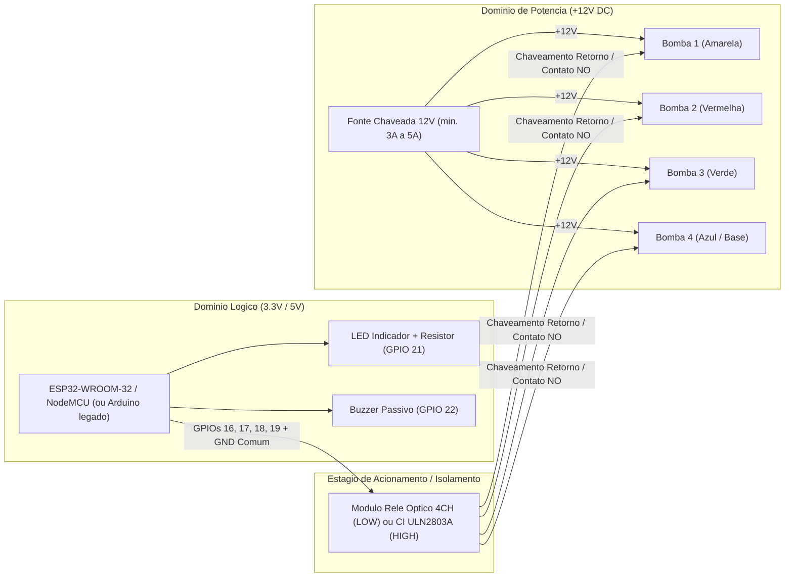

# ⚡ Engenharia Elétrica, Isolamento de Potência e PCB (`esquema/`)

Documentação eletroeletrônica completa e artefatos prontos para manufatura de Placa de Circuito Impresso (PCB) do **Bartender Automático**, incluindo projetos editáveis no **KiCad 9** e **Fritzing**, além de **16 fotolitos vetoriais em PDF** (versões normais e espelhadas).

---

## 💼 Valor para Engenharia de Produto & Escala Comercial

Passar de um protótipo em *protoboard* (cheio de fios jumper soltos que escapam durante o transporte em caminhão para eventos) para uma **PCI dedicada (PCB)** é o divisor de águas que transforma um experimento acadêmico em um **produto comercial locável e robusto**:

1. **Pronto para Fabricação Rápida ou Industrial:**
   Os arquivos `.kicad_pcb` / `.kicad_sch` permitem tanto gerar pacotes *Gerber* para produção industrial (JLCPCB / PCBWay a baixo custo unitário em lotes) quanto confeccionar placas localmente por transferência térmica/fotográfica usando os PDFs de cobre e máscara já exportados nesta pasta.
2. **Separação Clara entre Lógica (`3.3V / 5V`) e Potência Hidráulica (`12V DC`):**
   Os motores das 4 bombas operam em barramento exclusivo `+12V`, isolando o microcontrolador contra ruído eletromagnético (EMI) e surtos indutivos (*flyback*) gerados no desligamento das bobinas.
3. **Dupla Compatibilidade de Estágio Driver:**
   A arquitetura suporta tanto o **CI Array Darlington `ULN2803A`** (presente no esquemático `esquema.kicad_sch`, com diodos de roda-livre *flyback* integrados para cargas indutivas 12V até 500mA por canal — podendo paralelizar canais para correntes maiores) quanto **Módulos Relé Ópticos de 4 Canais** para bombas de diafragma de maior corrente (`1A` a `3A`), bastando ajustar a constante `RELE_ATIVO_EM_LOW` em `bombas/bombas.ino`.

---

## 🔌 Arquitetura Elétrica de Comando e Potência

### Regras de Ouro para Montagem de Bancada e Gabinete
- **Referência `GND` Unificada:** Quando utilizar `ULN2803A` ou acionamento direto de transistores, o `GND` da fonte `12V` **deve obrigatoriamente** estar interligado ao `GND` do ESP32. Em módulos relé com optoacoplador (jumper `JD-VCC` removido), mantenha a referência adequada conforme o modelo do módulo.
- **Diodos Flyback (`1N4007`) nas Bombas:** Motores DC de bombas geram picos reversos de tensão ao desligar; o `ULN2803A` já possui pino `COM` ligado ao `+12V` para supressão interna, mas em montagens com relés mecânicos recomenda-se colocar um diodo `1N4007` reversamente polarizado nos terminais de cada motor (`catodo` no `+12V`, `anodo` no negativo da bomba) para eliminar faíscas nos contatos do relé e evitar resets por EMI no Wi-Fi do ESP32.
- **Dimensionamento da Fonte 12V:** Graças ao intertravamento de software do firmware (`ligarBomba` aciona apenas 1 bomba por vez), uma fonte chaveada `12V / 3A` a `5A` opera com ampla folga térmica e estabilidade de tensão (o que mantém a vazão `ml/s` constante do início ao fim da festa!).

---

## 📂 Inventário Completo dos Arquivos de Projeto e Fabricação

### Projetos Editáveis (CAD Eletrônico)
| Arquivo | Software | Descrição |
| :--- | :---: | :--- |
| **`esquema.kicad_pro`** | KiCad 9 | Arquivo mestre de regras de projeto (DRC/ERC, larguras de trilha, *clearance* e template BOM). |
| **`esquema.kicad_sch`** | KiCad 9 | Diagrama esquemático elétrico (controlador, driver Darlington `ULN2803A`, barramentos `+12V` e `GND`). |
| **`esquema.kicad_pcb`** | KiCad 9 | Roteamento físico das trilhas e posicionamento de componentes da placa de circuito impresso. |
| **`esquema.kicad_prl`** | KiCad 9 | Preferências locais de visualização de camadas do editor de PCB. |
| **`Esquema_Eletrico.fzz`** | Fritzing | Projeto visual ilustrado de bancada e protoboard/PCB. |
| **`Esquema_Eletrico_bb.svg`** | Vetorial SVG | Diagrama visual de montagem em bancada (*breadboard view*) exportado em alta resolução. |
| **`esquema-backups/`** | Backup ZIP | Snapshot histórico de segurança do projeto KiCad. |

### Artefatos PDF para Confecção de PCB (Normal + Espelhado / *Mirror*)
| Camada da Placa | Face Superior (*Top*) | Face Inferior (*Bottom*) | Finalidade na Fabricação |
| :--- | :--- | :--- | :--- |
| **Trilhas de Cobre (`copper`)** | `..._copper_top.pdf` / `..._mirror.pdf` | `..._copper_bottom.pdf` / `..._mirror.pdf` | Corrosão das pistas condutoras de cobre. |
| **Máscara de Solda (`mask`)** | `..._mask_top.pdf` / `..._mirror.pdf` | `..._mask_bottom.pdf` / `..._mirror.pdf` | Verniz UV protetor isolante sobre as trilhas (expondo apenas as ilhas/pads). |
| **Pasta de Solda (`paste_mask`)** | `..._paste_mask_top.pdf` / `..._mirror.pdf` | `..._paste_mask_bottom.pdf` / `..._mirror.pdf` | Estêncil para aplicação de pasta de solda. |
| **Serigrafia (`silk`)** | `..._silk_top.pdf` / `..._mirror.pdf` | `..._silk_bottom.pdf` / `..._mirror.pdf` | Legenda de identificação e polaridade dos componentes na placa. |
