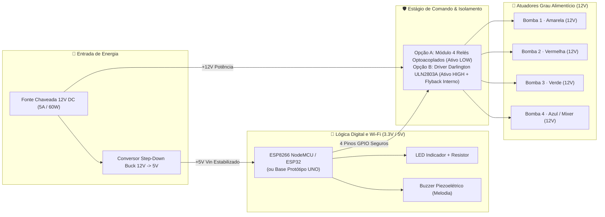

# ⚡ Engenharia Eletrônica, Potência 12V & Fabricação de PCB (`esquema/`)

Este diretório reúne os projetos originais de hardware eletrônico do **Bartender.OS**, incluindo esquemáticos editáveis em **KiCad 9.0** e **Fritzing**, layout de placa de circuito impresso (PCB) dupla face e todos os **16 gabaritos vetoriais PDF (normais e espelhados)** prontos para fabricação rápida de protótipos ou lotes industriais.

---

## 🔌 Arquitetura Elétrica e Isolamento de Potência (`3.3V/5V` ↔ `12V DC`)

Bombas peristálticas e bombas de diafragma grau alimentício (`12V DC`, `~1.0A–1.5A` cada) são **cargas fortemente indutivas**. Se acionadas sem supressão de transientes ou sem separação adequada de barramento, o pico de tensão reversa (*back-EMF* ao desligar o motor) reinicia o microcontrolador Wi-Fi no meio do drink.

O projeto eletrônico da máquina resolve esse problema em **duas arquiteturas homologadas**:

### Comparativo Técnico dos Estágios de Acionamento Suportados:

| Característica | Opção A: Módulo 4 Relés Optoacoplados (`PC817`) | Opção B: Placa Dedicada com `ULN2803A` (`esquema.kicad_sch`) |
| :--- | :--- | :--- |
| **Isolamento Galvânico** | Total (acoplamento óptico entre o GPIO `3.3V` do ESP e a bobina). | Barramento `GND` comum com estágio Darlington de alta tensão (`50V`) e diodos *clamp* internos no pino `COM (+12V)`. |
| **Proteção Contra Surto Indutivo (*Flyback*)** | Recomendado diodo `1N4007` em antiparalelo nos terminais de cada motor `12V` + capacitor cerâmico `100nF` anti-ruído RF. | Diodos *flyback* já integrados dentro do CI `ULN2803A` (pino `10` conectado ao `+12V`), ideal para cargas até `500mA` por canal (ou canais em paralelo para até `1.5A`). |
| **Configuração em `bombas.ino`** | `RELE_ATIVO_EM_LOW = true` *(padrão)* | `RELE_ATIVO_EM_LOW = false` |
| **Indicação Comercial** | Montagem modular rápida de campo e fácil substituição em manutenção. | Produção seriada compacta em PCB própria com zero partes mecânicas móveis. |

---

## 🗂️ Inventário dos Arquivos de Engenharia na Pasta `esquema/`

### 1. Projetos Editáveis (CAD Eletrônico)
| Arquivo | Ferramenta | Descrição |
| :--- | :--- | :--- |
| `esquema.kicad_pro` | KiCad 9.0 | Arquivo mestre do projeto com regras de DRC (*Design Rule Check*), *clearance* de `0.5mm` e *teardrops* habilitados nos pads. |
| `esquema.kicad_sch` | KiCad Eeschema | Esquemático elétrico completo contendo lógica de controle, barramento `+12V`/`GND` e array driver `ULN2803A` (`U1`). |
| `esquema.kicad_pcb` | KiCad PCBNew | Roteamento físico das trilhas da placa de circuito impresso. |
| `Esquema_Eletrico.fzz` | Fritzing | Projeto visual ilustrado de bancada (protoboard + esquemático + PCB). |
| `Esquema_Eletrico_bb.svg` | Navegador / Vetorial | Diagrama visual de ligações em alta resolução (`SVG`) para montagem rápida de bancada. |

### 2. Artes Finais PDF para Fabricação de PCB (Corrosão Térmica, CNC ou Fotolitografia)
Todos os gabaritos estão exportados em escala real **`1:1`** nas versões normal e espelhada (`_mirror`, ideal para transferência térmica *toner transfer*):

| Camada da Placa | Face Inferior (*Bottom*) | Face Superior (*Top*) |
| :--- | :--- | :--- |
| **Trilhas de Cobre (*Copper Etch*)** | `Esquema_Eletrico_etch_copper_bottom.pdf` / `*_mirror.pdf` | `Esquema_Eletrico_etch_copper_top.pdf` / `*_mirror.pdf` |
| **Máscara de Solda (*Solder Mask*)** | `Esquema_Eletrico_etch_mask_bottom.pdf` / `*_mirror.pdf` | `Esquema_Eletrico_etch_mask_top.pdf` / `*_mirror.pdf` |
| **Pasta de Solda SMD (*Paste Mask*)** | `Esquema_Eletrico_etch_paste_mask_bottom.pdf` / `*_mirror.pdf` | `Esquema_Eletrico_etch_paste_mask_top.pdf` / `*_mirror.pdf` |
| **Serigrafia de Componentes (*Silkscreen*)** | `Esquema_Eletrico_etch_silk_bottom.pdf` / `*_mirror.pdf` | `Esquema_Eletrico_etch_silk_top.pdf` / `*_mirror.pdf` |

---

## 🛡️ Checklist de Engenharia para Montagem Comercial (Segurança Alimentar & Elétrica)

1. **Mangueiras de Silicone Grau Alimentício Atóxico:** Utilize exclusivamente tubos de silicone platina translúcido próprios para bebidas alcoólicas e xaropes ácidos (cítricos), facilitando inspeção visual e higienização diária com água morna circulante.
2. **Válvulas Anti-Retorno (*Check Valves*) nos Pescadores:** Mantêm a coluna de líquido sempre preenchida até o bico dosador, garantindo que o primeiro pedido da noite tenha exatamente os mesmos mililitros dos demais (e reduzindo a perda de purga `loss_pct` cadastrada no `/painel`).
3. **Separação Física "Zona Seca × Zona Úmida" no Gabinete:** Aloje a fonte `12V`, a placa `ESP8266`/`ESP32` e os relés/PCB no compartimento superior ou traseiro vedado (*zona seca*), mantendo garrafas e conexões hidráulicas na parte inferior (*zona úmida*), garantindo durabilidade industrial em ambientes úmidos de bares e eventos.
