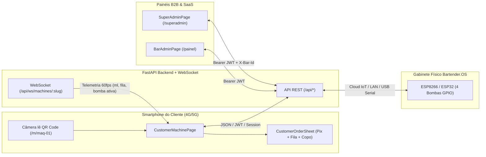

# 🍹 Bartender.OS v3.0 — Frontend Web Mobile-First & Painéis SaaS

Interface web unificada de **Autoatendimento Mobile via QR Code/Pix**, **ERP Operacional do Dono do Bar** e **Console Master Multi-Tenant (Super-Admin)** do ecossistema **Bartender.OS v3.0**.

---

## 💼 Visão Executiva & Argumentos de Vendas Técnicas (B2B / SaaS)

Em bares, baladas, beach clubs e eventos de alto fluxo, filas no caixa e desperdício de destilados corroem até **30% do faturamento potencial da noite**. O frontend do Bartender.OS v3.0 foi projetado sob medida para atacar essas dores nas 3 pontas do negócio:

| Persona | Rota Web | Diferencial Comercial Decisivo |
| :--- | :--- | :--- |
| **Consumidor Final** | `/m/:machineSlug` | **Compra em 3 toques no 4G/5G sem baixar app e sem pedir senha de Wi-Fi.** Escolha no cardápio ou monte por mililitro, pague via `Pix Copia e Cola`, receba alerta vibratório na sua vez e acione as bombas com trava anti-desperdício de copo. |
| **Dono / Gerente do Bar** | `/painel` ou `/admin` | **Gestão sem planilhas.** Cadastre garrafas pelo custo pago ou valor da dose de `50 ml` (conversão automática para `R$/ml`), crie receitas com preview visual em tempo real, acompanhe lucro líquido descontando insumos e configure recebimento Pix oficial Mercado Pago. |
| **Operador da Plataforma (SaaS)** | `/superadmin` | **Escalabilidade Hardware-as-a-Service + Split Pix.** Provisione um novo bar cliente + 1ª máquina vendida em 30 segundos, monitore GMV e receita recorrente de comissão (`% Split`) e acesse o painel de qualquer cliente em 1 clique para suporte remoto (*Impersonation*). |

> [!TIP]
> **Performance Extrema em Redes Móveis Congestionadas:** O bundle inteiro utiliza **React 19 + TypeScript 5.8 + Tailwind CSS v4 + Ilustrações Vetoriais SVG Nativas**, sem bibliotecas pesadas de roteamento ou bancos de fotos estáticas. Isso garante abertura quase instantânea mesmo em pistas lotadas com sinal 4G instável.

---

## 🏗️ Arquitetura Geral & Fluxo Ponta a Ponta



---

## 📂 Mapa de Diretórios da Pasta `frontend/`

Cada pasta e subpasta possui seu próprio `README.md` detalhando contratos, arquitetura e valor comercial:

- [`frontend/`](./README.md) — Configuração de build Vite 6, TypeScript estrito, dependências e visão executiva.
  - [`src/`](./src/README.md) — Bootstrap React 19 (`main.tsx`), roteador SPA leve (`App.tsx`) e Design System `"Tropical Craft"` (`index.css`).
    - [`src/api/`](./src/api/README.md) — Cliente HTTP tipado (`bartenderApi`), injeção de JWT e header multi-tenant `X-Bar-Id`.
    - [`src/types/`](./src/types/README.md) — Contratos TypeScript espelhados 1:1 com os schemas Pydantic do backend.
    - [`src/utils/`](./src/utils/README.md) — Formatação monetária precisa em centavos (`R$` e `R$/ml`), sessão anônima e navegação SPA.
    - [`src/pages/`](./src/pages/README.md) — Orquestradores das 3 jornadas (`CustomerMachinePage`, `BarAdminPage`, `SuperAdminPage`).
    - [`src/components/`](./src/components/README.md) — Componentes visuais do consumidor (`GlassArtwork`, `CustomDrinkBuilder`, `CustomerOrderSheet`, `DrinkCard`, `Navbar`, `TropicalDecor`).
      - [`src/components/admin/`](./src/components/admin/README.md) — Módulos CRUD do dono do bar (`BottlesCrudSection`, `DrinksCrudSection`, `MachinesPumpsSection`).

---

## ⚙️ Stack Tecnológica & Scripts

- **Runtime UI:** React `^19.1.0` + `react-dom`
- **Tipagem:** TypeScript `~5.8.3` (`strict: true`, `noUnusedLocals: true`, `noUnusedParameters: true`)
- **Estilização:** Tailwind CSS `^4.1.7` via `@tailwindcss/vite` + Google Fonts (`Fraunces` & `Plus Jakarta Sans`)
- **Ícones:** `lucide-react` `^0.511.0`
- **Bundler & Dev Server:** Vite `^6.3.5` (porta `5174` com proxy HTTP + WebSocket para `http://localhost:8010`)

### Comandos Principais

```powershell
# Instalar dependências
npm install

# Rodar servidor de desenvolvimento com HMR e proxy p/ FastAPI (:8010)
npm run dev

# Validar tipagem TypeScript (tsc -b) e gerar bundle de produção em dist/
npm run build

# Pré-visualizar o bundle compilado localmente
npm run preview
```

> [!IMPORTANT]
> Em produção ou execução unificada pelo backend Python, o FastAPI serve diretamente os artefatos estáticos compilados em `frontend/dist/`. Sempre execute `npm run build` após alterações no frontend para atualizar o bundle servido pelo backend.
