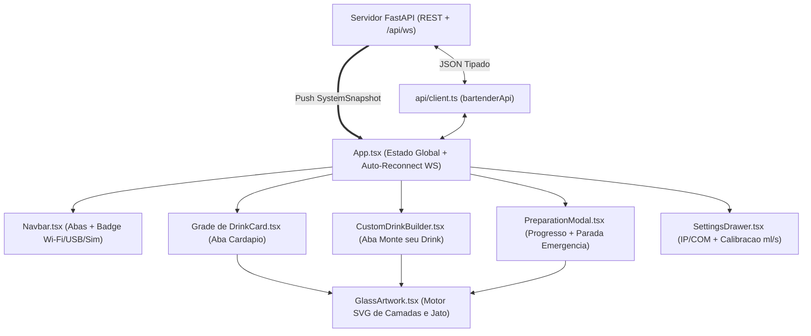

# 🧠 Arquitetura de Estado & Design System (`frontend/src/`)

Código-fonte principal da aplicação React, responsável por unir **estado reativo**, **streaming WebSocket resiliente** e **identidade visual tropical**.

---

## 💼 Confiabilidade em Operação de Longa Duração (Festas de 8h+)

Em totens de autoatendimento que ficam ligados durante toda uma festa ou feira de negócios, páginas web mal projetadas costumam "congelar" o status se o roteador Wi-Fi piscar por alguns segundos. O núcleo em `src/App.tsx` evita esse problema com três mecanismos de engenharia:

1. **Auto-Reconexão Silenciosa de WebSocket (`2.5s`):**
   O hook dedicado em `App.tsx` monitora o evento `ws.onclose`. Caso o sinal Wi-Fi oscile ou o backend seja reiniciado rapidamente, o navegador reconecta sozinho em `2500 ms` e sincroniza imediatamente o `SystemSnapshot` atual, sem exigir `F5` manual da equipe.
2. **Detecção Automática de Preparo em Curso:**
   Se um convidado abrir o link do bar no celular exatamente enquanto uma bebida já está sendo servida na máquina (`snap.status.state === 'dispensing'`), o `PreparationModal` abre automaticamente na tela dele mostrando o progresso real.
3. **Recálculo Instantâneo Pós-Calibração:**
   Quando o operador altera a vazão (`ml/s`) ou o nome de uma garrafa no painel ⚙️ (`handleSavePump`), o `App.tsx` dispara uma atualização paralela (`Promise.all`) de `/api/drinks` e `/api/pumps`, refletindo novos tempos estimados e nomes de ingredientes em toda a interface na mesma hora.

---

## 🔄 Fluxo de Dados no Frontend

---

## 📄 Arquivos Diretos em `src/`

| Arquivo | Responsabilidade |
| :--- | :--- |
| **`main.tsx`** | Monta a árvore concorrente do React 19 (`createRoot`) sob `<React.StrictMode>` e carrega o CSS global. |
| **`App.tsx`** | Componente orquestrador: gerencia abas (`menu` vs `custom`), filtro por categorias, trava de concorrência visual (`isBusy`), banner de erro acionável e ciclo de vida do WebSocket. |
| **`index.css`** | Design system em **Tailwind CSS v4** com gradientes solares atmosféricos, textura `.linen-card`, sliders táteis customizados (`.pump-slider` com cor dinâmica `--slider-accent`) e animações `@keyframes` aceleradas por GPU (`floatBubble`, `pulseStream`, `breezeLeft`/`breezeRight`). |

### Subpastas
- **[`api/`](./api/README.md)** — Camada de comunicação HTTP (`bartenderApi`).
- **[`components/`](./components/README.md)** — Componentes visuais modulares.
- **[`types/`](./types/README.md)** — Tipagem estática compartilhada.
