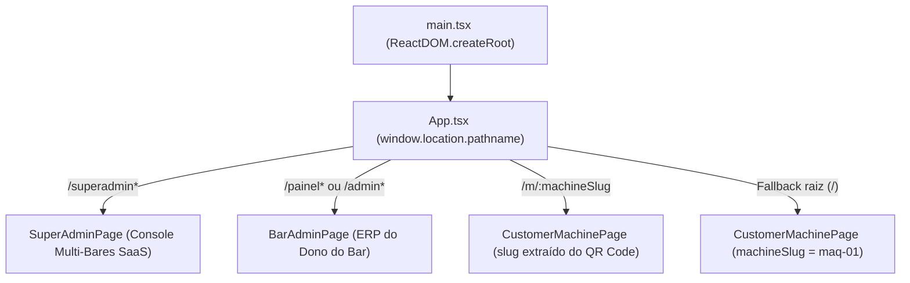

# 🎨 `src/` — Núcleo da Aplicação SPA, Roteamento & Design System

Esta pasta concentra o ponto de montagem da aplicação React 19, o roteador SPA ultraleve baseado na History API nativa e o Design System sensorial **"Tropical Craft"** que define toda a identidade visual do **Bartender.OS v3.0**.

---

## 🚀 Por Que Esta Camada Vende Mais (UX & Engenharia)

1. **Zero Dependência de Roteamento Externo (`App.tsx`):**
   Ao utilizar `window.location.pathname` + listener nativo `popstate` em vez de pacotes externos robustos, economizamos kilobytes críticos no carregamento inicial pelo 4G do cliente em frente à máquina.
2. **Design Gastronômico que Aumenta Conversão (`index.css`):**
   Máquinas automáticas tradicionais têm telas frias de painel fabril. O Bartender.OS aposta em texturas orgânicas de papel algodão (`.linen-card`), iluminação solar radial e tipografia editorial serifada (`Fraunces`) para despertar desejo imediato por coquetelaria artesanal — elevando a conversão de bebidas de maior margem.
3. **Animações 60fps Aceleradas por GPU:**
   Todas as animações CSS (`@keyframes floatBubble`, `pulseStream`, `breezeLeft`, `breezeRight`) manipulam exclusivamente `transform` e `opacity`, evitando *layout thrashing* e poupando bateria em smartphones intermediários.

---

## 🧭 Arquitetura de Rotas SPA (`App.tsx`)

---

## 📄 Arquivos Diretos Desta Pasta

| Arquivo | Responsabilidade Técnica | Impacto no Produto |
| :--- | :--- | :--- |
| [`main.tsx`](./main.tsx) | Inicializa `ReactDOM.createRoot` sob `React.StrictMode` e importa `index.css`. | Garante ciclo de vida limpo de WebSockets e timers em navegadores mobile. |
| [`App.tsx`](./App.tsx) | Roteador reativo por URL (`popstate`) que despacha para as 3 páginas principais. | Isola claramente consumidor final, dono do bar e operador SaaS no mesmo deploy. |
| [`index.css`](./index.css) | Configuração Tailwind v4, fontes editoriais, cartões `.linen-card`, sliders `.pump-slider` e animações SVG. | Confere acabamento visual de marca premium pronto para bares, franquias e eventos VIP. |

---

## 📁 Subpastas de `src/`

- [`api/`](./api/README.md) — Comunicação REST centralizada, autenticação JWT e cabeçalho de inspeção `X-Bar-Id`.
- [`components/`](./components/README.md) — Componentes interativos do consumidor e motor vetorial do copo (`GlassArtwork`).
  - [`components/admin/`](./components/admin/README.md) — Seções CRUD especializadas para garrafas, cardápio e máquinas/bombas.
- [`pages/`](./pages/README.md) — Páginas completas de cada jornada de usuário.
- [`types/`](./types/README.md) — Tipagem estrita de domínio e contratos da API.
- [`utils/`](./utils/README.md) — Moeda (`R$` / `R$/ml`), sessão persistente do cliente e helpers de navegação.
