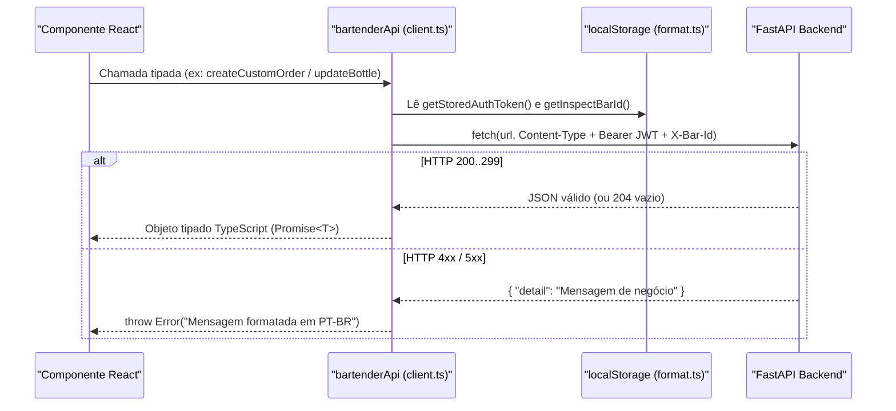

# 🌐 `src/api/` — Camada de Integração REST Multi-Tenant

Módulo responsável por toda a comunicação HTTP assíncrona entre o navegador (cliente mobile, dono do bar ou Super-Admin) e o servidor **FastAPI** do **Bartender.OS v3.0**.

---

## 💡 Diferenciais Técnicos & Comerciais

- **Zero Biblioteca Externa (`fetch` Nativo Tipado):** Mantém o bundle enxuto e padroniza headers, serialização JSON e captura de erros em uma única função `requestJson<T>()`.
- **Governança Multi-Tenant Transparente (`X-Bar-Id`):** Quando o Super-Admin clica em *"Gerenciar Garrafas / Drinks deste Bar"* no console global, `requestJson` passa a injetar automaticamente o cabeçalho `X-Bar-Id` junto ao `Authorization: Bearer <token>`. Assim, o mesmo código de CRUD do dono do bar funciona para suporte técnico remoto B2B sem duplicar endpoints!
- **Mensagens de Erro Humanizadas para Balcão:** Extrai automaticamente strings diretas ou listas de validação do Pydantic (`data.detail`) para exibir avisos claros em português (ex.: *"Estoque insuficiente na Bomba Azul"* ou *"Pedido mínimo é R$ 5,00"*).

---

## 🔄 Fluxo de Requisição e Injeção de Contexto

---

## 📑 Catálogo de Métodos em [`client.ts`](./client.ts)

### 1. Autenticação (`/api/auth/*`)
- `login(email, password)` — Autentica `bar_owner` ou `superadmin` e devolve `AuthTokenResponse`.
- `getMe()` — Valida sessão atual e retorna `PrincipalUser`.

### 2. Jornada Pública do Cliente via QR Code (`/api/public/*`)
- `listPublicMachines()` — Lista máquinas públicas ativas.
- `getPublicMachine(slug, sessionId)` — Carrega cardápio, bombas, fila e `active_customer_order` para retomada automática.
- `createPresetOrder(machineSlug, payload)` — Abre cobrança Pix para drink pronto do cardápio.
- `createCustomOrder(machineSlug, payload)` — Abre cobrança Pix para receita personalizada por `ml` nas 4 bombas.
- `getOrder(orderId)` — Polling leve do status do pedido e cronômetros de Pix/vez.
- `simulatePayOrder(orderId)` — Liquidação instantânea para demonstrações comerciais em modo `simulated`.
- `cancelOrder(orderId, sessionId)` — Cancela pedido pendente de pagamento.
- `resumeOrderTurn(orderId, sessionId)` — Retoma vez pausada (`PAUSED_TURN`) ou renova tempo para pegar copo/gelo.
- `confirmCupAndDispense(orderId, sessionId, confirmed)` — Envia trava obrigatória de copo posicionado e inicia dosagem física.

### 3. ERP do Dono do Bar (`/api/bar/*`)
- **Configurações & Pix:** `getBarSettings()`, `updateBarSettings(payload)`
- **Garrafas (`R$/ml`):** `listBottles()`, `createBottle(payload)`, `updateBottle(id, payload)`, `deleteBottle(id)`
- **Cardápio de Drinks:** `listBarDrinks()`, `createDrink(payload)`, `updateDrink(id, payload)`, `deleteDrink(id)`
- **Máquinas & Bombas:** `listMachines(probe)`, `createMachine(payload)`, `updateMachine(id, payload)`, `updatePumpSlot(machineId, pumpId, payload)`, `refillPump(machineId, pumpId, remainingMl)`, `emergencyStopMachine(machineId)`
- **Financeiro & Pós-Venda:** `listBarOrders()`, `getBarAnalytics()`, `refundOrder(orderId)`, `retryOrder(orderId)`

### 4. Super-Admin Multi-Bares (`/api/superadmin/*`)
- `getPlatformOverview()` — KPIs globais de bares ativos, máquinas, GMV Pix e comissões Split.
- `createBarTenant(payload)` — Onboarding B2B atômico (Bar + Proprietário + 1ª Máquina).
- `updateBarTenant(barId, payload)` — Atualização contratual e de taxa `% Split`.
- `deleteBarTenant(barId)` — Remoção completa de tenant.
