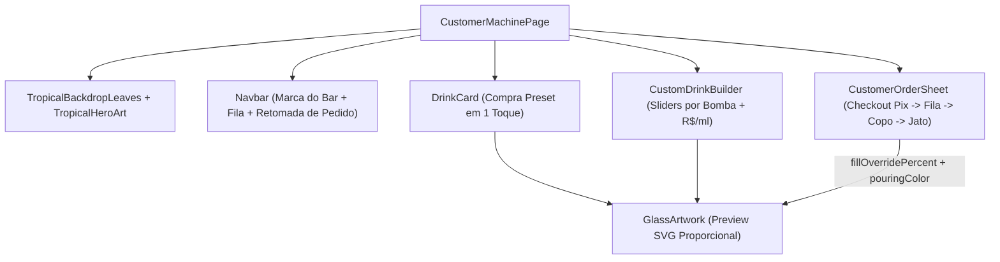

# 🥂 `src/components/` — Componentes de Autoatendimento Mobile & Visualização Ao Vivo

Esta pasta reúne os componentes de interface voltados à **conversão de vendas no smartphone do cliente** e à **representação vetorial realista dos coquetéis** (compartilhada também com o editor de cardápio do dono do bar).

---

## 🎯 Argumentos Comerciais Embutidos nos Componentes

1. **"O Cliente Compra com os Olhos" (`GlassArtwork.tsx`):**
   Diferente de cardápios digitais estáticos que exigem fotógrafo cada vez que o bar muda uma bebida, o `GlassArtwork` desenha matematicamente em SVG um copo Highball com gelo, hortelã, limão, canudo listrado e **camadas líquidas proporcionais aos mililitros reais** das garrafas instaladas naquele minuto!
2. **Aumento de Ticket Médio por Gamificação (`CustomDrinkBuilder.tsx`):**
   Na aba *"Monte por ml"*, o consumidor ajusta doses com sliders ou botões rápidos (`-25ml`, `+25ml`, `+50ml`) vendo o preço por mililitro (`R$/ml`) transparente e o copo mudando de cor na hora. A pré-seleção inteligente já abre sugerindo `50 ml` de destilado + mixer para acelerar o pedido.
3. **Zero Desperdício de Bebida & Zero Fila Travada (`CustomerOrderSheet.tsx`):**
   - **Pix Copia e Cola em 1º Plano:** Projetado para quem está com o celular na mão (com QR Code secundário expansível).
   - **Fila Inteligente com Crédito Protegido (`PAUSED_TURN`):** Se o cliente pagou da mesa e demorou para caminhar até a máquina, o sistema libera o próximo da fila sem cancelar o drink pago — basta tocar em *"Já estou na frente da máquina"* ao chegar!
   - **Checklist Obrigatório do Copo (`READY_FOR_CUP`):** Vibra o celular (`navigator.vibrate`) e só liga as bombas após confirmação explícita de que há um copo vazio posicionado na bandeja.

---

## 🧩 Relação entre os Componentes Visuais

---

## 📦 Inventário de Componentes

| Arquivo | Função Principal | Destaques de UX & Engenharia |
| :--- | :--- | :--- |
| [`Navbar.tsx`](./Navbar.tsx) | Cabeçalho fixo com identificação do Bar/Máquina, seletor `Cardápio` vs `Monte por ml` e botão pulsante de pedido ativo. | Impede que o cliente perca o acompanhamento do pedido caso feche o modal temporariamente. |
| [`DrinkCard.tsx`](./DrinkCard.tsx) | Card de receita pronta com badges, aviso legal `+18`, tempo em segundos, barra de proporções e botão Pix. | Bloqueia compra automaticamente quando falta insumo e exibe `unavailable_reason`. |
| [`CustomDrinkBuilder.tsx`](./CustomDrinkBuilder.tsx) | Misturador interativo das 4 bombas com cálculo de preço espelhado ao servidor. | Trava submissão se `< 10 ml` ou se ultrapassar `maxCupMl` / `available_ml` da garrafa. |
| [`CustomerOrderSheet.tsx`](./CustomerOrderSheet.tsx) | Bottom-sheet responsivo que conduz as 4 etapas pós-escolha: Pix, Fila, Confirmação de Copo e Preparo Ao Vivo. | Inclui modo Sandbox (`Simular Confirmação Instantânea do Banco`) para demos comerciais B2B. |
| [`GlassArtwork.tsx`](./GlassArtwork.tsx) | Renderizador SVG paramétrico de copo Highball (`sm`, `md`, `lg`) com IDs isolados via `React.useId()`. | Anima jato colorido (`pouringColor`) e enchimento gradual sincronizado com o WebSocket da máquina. |
| [`TropicalDecor.tsx`](./TropicalDecor.tsx) | Arte vetorial leve de folhagens com brisa suave e pôr do sol tropical no banner principal. | `< 3 KB` sem requisições de imagens externas, mantendo performance máxima no 4G. |

---

## 🛠️ Subpasta Administrativa

- [`admin/`](./admin/README.md) — Componentes de gestão exclusivos do Dono do Bar (CRUD de Garrafas, CRUD de Drinks e Controle de Máquinas/Bombas).
