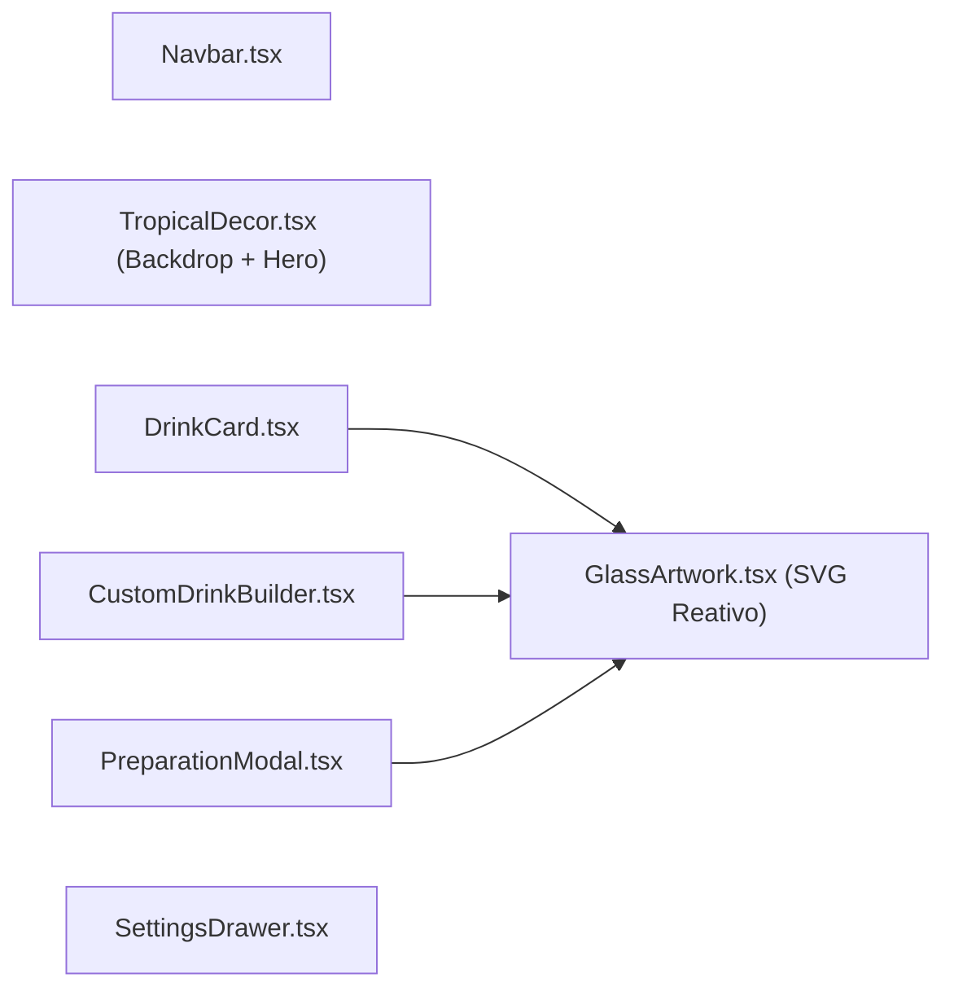

# 🎨 Biblioteca de Componentes Visuais (`frontend/src/components/`)

Conjunto modular de **7 componentes React + TypeScript** que compõem a experiência visual, interativa e administrativa do **Bartender.OS v2.0**.

---

## 💼 Destaques para Demonstrações Comerciais (Pré-Venda)

Durante uma apresentação comercial para organizadores de eventos, casas noturnas ou patrocinadores de estandes, vale destacar três componentes-chave desta pasta:

- **O Efeito "Uau" do `GlassArtwork.tsx`:** Mostre na aba *"Monte seu Drink"* como arrastar o slider de qualquer garrafa altera instantaneamente o nível real de líquido dentro do copo Highball, empilhando as cores exatas dos xaropes, flutuando os cubos de gelo na superfície e subindo borbulhas de gás.
- **Segurança Visível no `PreparationModal.tsx`:** Inicie qualquer drink (mesmo em *Modo Demonstração*) e clique em **"Parar Agora (Desligar Bombas)"** para demonstrar ao cliente que a equipe do bar tem controle absoluto contra desperdícios ou retirada acidental do copo.
- **Autonomia Operacional no `SettingsDrawer.tsx`:** Abra o ícone de engrenagem ⚙️ no topo direito para mostrar que um barman — sem saber uma linha de programação — consegue renomear as 4 garrafas do dia e calibrar a vazão em `ml/s` em menos de 30 segundos.

---

## 🧩 Catálogo Técnico dos Componentes

| Componente | Papel Visual e Funcional | Principais Props / Detalhes Técnicos |
| :--- | :--- | :--- |
| **`Navbar.tsx`** | Cabeçalho *sticky* translúcido (`backdrop-blur-xl`) com logotipo, seletor de abas (`Cardápio` / `Monte seu Drink`) e semáforo ao vivo do hardware. | Exibe badges distintos para `ESP32 Wi-Fi` (verde), `USB (COMx)` (azul), `Modo Demonstração` (âmbar) e `ESP32 Offline` (vermelho). |
| **`DrinkCard.tsx`** | Cartão comercial de cada receita do cardápio com selo temático, volume (`ml`), tempo estimado (`s`), copo vetorial e barra de proporções. | Resolve dinamicamente os nomes e cores atuais das garrafas via `pumpsById` e trava o botão quando `disabled={isBusy}`. |
| **`CustomDrinkBuilder.tsx`** | Estúdio interativo de mixologia em duas colunas para criação de bebidas personalizadas. | Sliders quantizados de `5 em 5 ml`, botões rápidos `-25ml` / `+25ml`, 3 presets instantâneos, cálculo local de tempo (incluindo pausas de `1.2s`) e travas de segurança (`10 ml` a `450 ml`). |
| **`GlassArtwork.tsx`** | Motor gráfico SVG puro (`viewBox="0 0 200 230"`) que desenha o copo Highball em camadas proporcionais. | Usa `React.useId()` para isolar `<clipPath>` entre cards, soma `+1px` por fatia contra frestas de anti-aliasing e anima o jato ativo (`pouringColor`) durante o preparo. |
| **`PreparationModal.tsx`** | Janela modal de acompanhamento em tempo real alimentada pelo WebSocket (`/api/ws`). | Exibe barra percentual colorida pela bomba ativa, cronômetro decorrido vs estimado e botão crítico de **Parada de Emergência**. |
| **`SettingsDrawer.tsx`** | Gaveta lateral administrativa de conectividade e calibração hidráulica. | Permite escolher entre os 4 modos (`auto`, `wifi`, `serial`, `simulator`), listar portas `COM` detectadas, testar conexão e gravar `flow_rate_ml_s` no servidor e na NVS do ESP32. |
| **`TropicalDecor.tsx`** | Cenografia botânica SVG (`TropicalBackdropLeaves` + `TropicalHeroArt`). | Gráficos vetoriais ultraleves com `pointer-events-none` (zero interferência em toques) e movimento suave de brisa via CSS. |

---

## 🔗 Relação de Composição Visual

