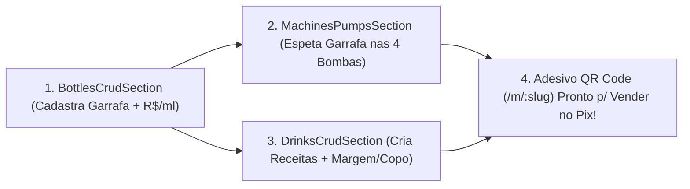

# 🧰 `src/components/admin/` — Módulos CRUD & Operação de Balcão do Dono do Bar

Submódulos administrativos renderizados dentro de [`BarAdminPage`](../../pages/BarAdminPage.tsx) (e também acessíveis via *Impersonation* pelo Super-Admin). Projetados para que qualquer gerente de bar ou barman opere máquinas automáticas **sem conhecimento técnico nem planilhas financeiras externas**.

---

## 💰 Argumentos de Vendas B2B Destes Módulos

### 1. Calculadora Inteligente de Precificação em 3 Vias ([`BottlesCrudSection.tsx`](./BottlesCrudSection.tsx))
Donos de bares pensam em **custo da garrafa**, **preço da dose de 50 ml** ou **multiplicador de markup** — nunca em centavos por mililitro. A calculadora resolve isso instantaneamente:
- Informe o volume (ex.: `750 ml`), custo pago (ex.: `R$ 65,00`) e perda de escorva/mangueira (ex.: `3%` -> `728 ml` úteis).
- Edite **qualquer um dos 3 controles sincronizados**:
  1. **Preço de 1 Dose (`50 ml`):** ex.: digite `R$ 10,00` e o sistema grava `R$ 0,20/ml`;
  2. **Faturamento da Garrafa Útil:** digite quanto quer apurar na garrafa inteira;
  3. **Botões de Markup Rápido:** `2x`, `2.5x`, `3x` ou `4x Custo`.
- O card mostra imediatamente o **Lucro Líquido Estimado por Garrafa**!

### 2. Engenharia Visual de Cardápio & Margem por Copo ([`DrinksCrudSection.tsx`](./DrinksCrudSection.tsx))
- Permite montar receitas de até **6 etapas sequenciais** escolhendo qual bomba acionar (`amarelo`, `vermelho`, `verde`, `azul`), quantos `ml` despejar e a pausa em milissegundos entre camadas.
- Enquanto o dono edita os `ml`, um mini `GlassArtwork` ao lado desenha o copo em tempo real e compara a **Soma Avulsa dos ml** com o **Preço Final** (`Automático por ml` com `% desconto combo` ou `Preço Fixo` tabelado).
- Na lista de drinks, cada item exibe `Custo Líquido` (CMV) e `Lucro/copo`, além de botão rápido de **Ocultar/Reativar** (`Eye` / `EyeOff`) caso falte gelo ou guarnição na noite.

### 3. Gestão Plug-and-Play de Máquinas, Bombas e QR Codes ([`MachinesPumpsSection.tsx`](./MachinesPumpsSection.tsx))
- **Adesivo QR Code Pronto para Gráfica:** Exibe e permite baixar em 1 clique o arquivo vetorial `.svg` (`/api/public/m/:slug/qr.svg`) de cada máquina instalada.
- **Troca de Garrafa em 3 Segundos:** Barra visual colorida mostra os `ml` restantes de cada bomba (ficando vermelha abaixo de `20%`). Ao trocar o vasilhame, um toque em **"Troquei por Garrafa Cheia"** restaura 100% do estoque.
- **Credenciais IoT Auto-Geradas (`secrets.h`):** Gera o bloco `#define SECRET_API_TOKEN` e `#define SECRET_CLOUD_SYNC_URL` pronto para gravar no firmware ESP8266/ESP32, além de seletor de transporte (`auto`, `cloud_iot`, `wifi`, `serial`, `simulator`), calibração de vazão (`ml/s`) e **Parada de Emergência**.

---

## 🔗 Fluxo Operacional do Estabelecimento

---

## 📄 Resumo Técnico dos Arquivos

| Arquivo | Endpoints Consumidos (`bartenderApi`) | Principais Estados & Validações |
| :--- | :--- | :--- |
| [`BottlesCrudSection.tsx`](./BottlesCrudSection.tsx) | `createBottle`, `updateBottle`, `deleteBottle` | Conversão bidirecional `dose50 <-> bottleTarget <-> pricePerLiterCents`; alerta de segurança ao excluir garrafa em uso (`installed_in_pumps > 0`). |
| [`DrinksCrudSection.tsx`](./DrinksCrudSection.tsx) | `createDrink`, `updateDrink`, `deleteDrink` | `useMemo` `livePreview` para camadas SVG e cálculo de preço; limite de `1..6` etapas de `5..400 ml`. |
| [`MachinesPumpsSection.tsx`](./MachinesPumpsSection.tsx) | `createMachine`, `updateMachine`, `updatePumpSlot`, `refillPump`, `emergencyStopMachine` | Sanitização regex `^[a-z0-9-]+$` para slugs de QR Code; rascunhos independentes de vazão `flowDrafts` por `machineId:pumpId`. |
