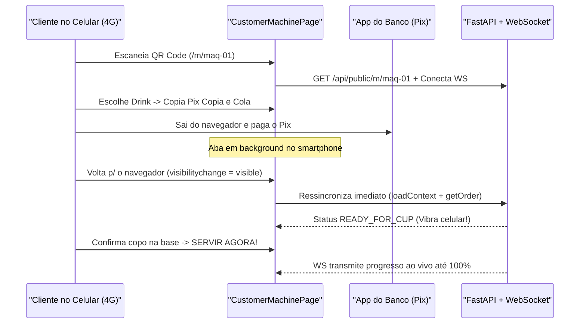

# 📱 `src/pages/` — Orquestradores das 3 Jornadas do Produto

Cada arquivo desta pasta representa uma **aplicação completa e independente** dedicada a uma das três personas do modelo de negócios **B2B2C / SaaS** do **Bartender.OS v3.0**.

---

## 🌟 As 3 Jornadas Comerciais & Técnicas

### 1. [`CustomerMachinePage.tsx`](./CustomerMachinePage.tsx) — Autoatendimento Mobile (`/m/:machineSlug`)
Projetada para operar em ambientes hostis de conectividade (bares subterrâneos, festas universitárias, eventos ao ar livre no 4G/5G):
- **Sessão Instantânea sem Login:** Identifica o aparelho via `getOrCreateCustomerSessionId()` e já restaura `active_customer_order` caso o cliente recarregue a página.
- **Arquitetura de Tripla Sincronização Resiliente:**
  1. **WebSocket em Tempo Real (`/api/ws/machines/:slug`):** Atualiza instantaneamente progresso das bombas (`0..100%`), tamanho da fila e estoque das garrafas, reconectando sozinho em `2.5s` se cair.
  2. **Reconexão Instantânea Pós-Banco (`visibilitychange`):** Quando o cliente copia o Pix, alterna para o app do banco (o iOS/Android congela a aba do navegador em background) e retorna após pagar, o listener `visibilitychange` dispara `loadContext()` + `refreshOrder()` no exato instante em que a tela reaparece!
  3. **Polling Leve de Segurança (`2.2s`):** Ativo apenas enquanto houver pedido não-finalizado, garantindo transição suave mesmo se pacotes WebSocket forem perdidos na troca de torre 4G.

---

### 2. [`BarAdminPage.tsx`](./BarAdminPage.tsx) — ERP do Dono do Bar (`/painel` ou `/admin`)
Central de comando comercial e financeira do estabelecimento licenciado:
- **Carregamento Paralelo (`Promise.all`):** Busca simultaneamente garrafas, drinks, máquinas, pedidos, analytics e configurações Pix em uma única rodada de rede.
- **4 KPIs Executivos Sempre Visíveis:**
  - *Faturamento Pix Pago* (`gross_revenue_cents` + contagem de pedidos);
  - *Custo das Garrafas Usadas* (`total_cost_cents` + litros servidos);
  - *Lucro Líquido do Bar* (`net_profit_cents` já livre de CMV e taxa da plataforma);
  - *Modo Pix Atual* (`Mercado Pago Oficial` vs `Pix Simulado`).
- **Gestão de Exceções de Balcão:** Na aba *Vendas & Fila Pix*, pedidos interrompidos (`FAILED_DISPENSE`) exibem botão direto de **"Reenviar à Fila"**, e qualquer pedido pago elegível pode receber **"Estornar Pix"** com confirmação de segurança.
- **Chaveamento Mercado Pago Oficial:** Permite colar o `Access Token` (`APP_USR-...` ou `TEST-...`), visualizar o token mascarado salvo e copiar a URL exclusiva de Webhook automático daquele bar (`/api/webhooks/mercadopago/:barId`).

---

### 3. [`SuperAdminPage.tsx`](./SuperAdminPage.tsx) — Console Master Multi-Bares (`/superadmin`)
Painel executivo para quem comercializa/opera a plataforma SaaS e o parque de máquinas:
- **Visão Consolidada da Rede:** Total de Bares Ativos, Total de Máquinas Instaladas, Volume Pix Global (GMV) e **Receita Split da Plataforma** acumulada.
- **Provisionamento Multi-Tenant em 1 Passo:** O formulário *"Cadastrar Novo Bar Cliente"* gera slug automático a partir do nome, define a taxa percentual de comissão (`platform_fee_percent`), cria a credencial do dono do bar e já entrega a 1ª máquina configurada com código QR Code.
- **Impersonation / Suporte Remoto B2B:** Ao clicar em *"Gerenciar Garrafas / Drinks deste Bar"*, grava o ID do bar via `setInspectBarId(bar.id)` e navega para `/painel`, permitindo configurar toda a operação para o cliente recém-contratado.

---

## 🔑 Credenciais Padrão de Demonstração

Para apresentações comerciais e homologação local:
- **Dono do Bar (`/painel`):** `dono@bartropical.com` / `bar123`
- **Super-Admin SaaS (`/superadmin`):** `superadmin@bartender.os` / `admin123`
