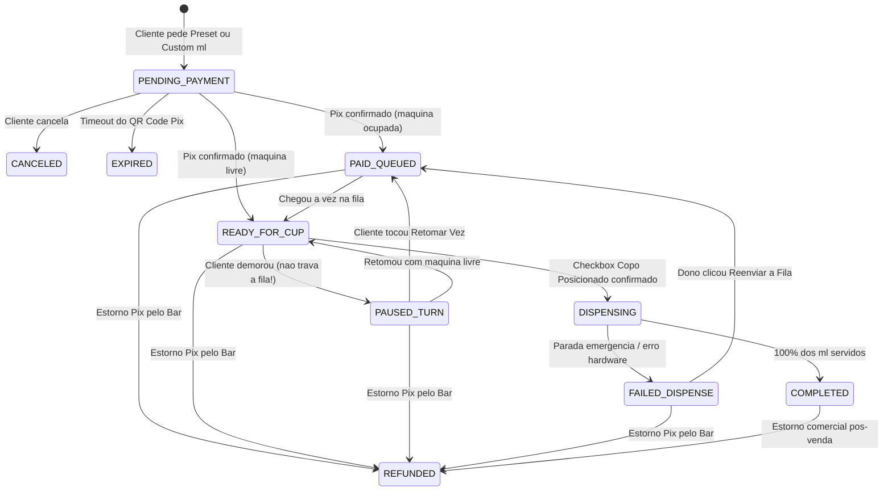

# 📐 `src/types/` — Contratos TypeScript & Máquina de Estados de Domínio

Centraliza todas as interfaces e tipos estritos (`strict: true`) do frontend em [`bartender.ts`](./bartender.ts), espelhando **1:1** os modelos Pydantic do backend FastAPI.

---

## 🛡️ Por Que Tipagem Estrita Importa Comercialmente Aqui

Em um sistema que movimenta **pagamentos reais via Pix** e **aciona bombas físicas de líquidos**, ambiguidades de tipo causam prejuízo financeiro direto ou derramamento no balcão. Por isso:
1. **Todos os valores monetários trafegam em centavos inteiros (`*_cents`):** Evita divergências de arredondamento IEEE-754 entre o valor exibido no celular e o QR Code EMV gerado no Banco Central.
2. **Identificação física determinística (`PumpId`):** Restringe em tempo de compilação qualquer referência de bomba ao conjunto literal `'amarelo' | 'vermelho' | 'verde' | 'azul'`.
3. **Máquina de Estados Explícita (`OrderStatus`):** Garante que a UI trate todos os cenários operacionais reais de um bar movimentado (fila, pausa de vez, confirmação de copo, falha física e estorno).

---

## 🔄 Diagrama da Máquina de Estados do Pedido (`OrderStatus`)

---

## 📚 Grupos de Interfaces em [`bartender.ts`](./bartender.ts)

| Domínio | Principais Tipos & Interfaces | Papel no Ecossistema |
| :--- | :--- | :--- |
| **Autenticação & RBAC** | `PrincipalUser`, `AuthTokenResponse` | Separa permissões entre `'bar_owner'` (escopo de 1 bar) e `'superadmin'` (escopo multi-tenant global). |
| **Insumos & Precificação** | `Bottle`, `BottlePayload`, `DrinkPricingMode` | Modela perda técnica de mangueira (`loss_pct`), preço base por litro (`price_per_liter_cents`) e lucro estimado por garrafa. |
| **Engenharia de Cardápio** | `DoseStep`, `DrinkRecipe`, `DrinkPayload` | Sequência de bombas + `ml` + `pause_ms`, CMV por copo, margem estimada e disponibilidade automática por estoque. |
| **Hardware & IoT** | `ConnectionMode`, `PrepState`, `PumpSlot`, `PreparationStatus`, `HardwareHealth`, `Machine` | Conecta parâmetros de GPIO, vazão (`flow_rate_ml_s`), conectividade Cloud IoT / LAN / USB Serial e barra de progresso ao vivo. |
| **Checkout Pix & Fila** | `PaymentProvider`, `OrderStatus`, `OrderItemBreakdown`, `Order` | Controla `pix_qr_code` (Copia e Cola), `pix_qr_base64`, posição na fila, contadores regressivos e Split (`platform_fee_cents` vs `bar_net_cents`). |
| **Tempo Real & Contexto** | `MachinePublicContext`, `MachineRealtimeSnapshot`, `PublicMachineSummary` | Payloads otimizados para abertura rápida do QR Code e streaming WebSocket de baixa latência. |
| **Gestão B2B & SaaS** | `BarSettings`, `BarAnalytics`, `BarSummary`, `PlatformOverview` | Suporta DRE em tempo real do bar, configuração segura Mercado Pago e governança financeira da rede inteira. |
